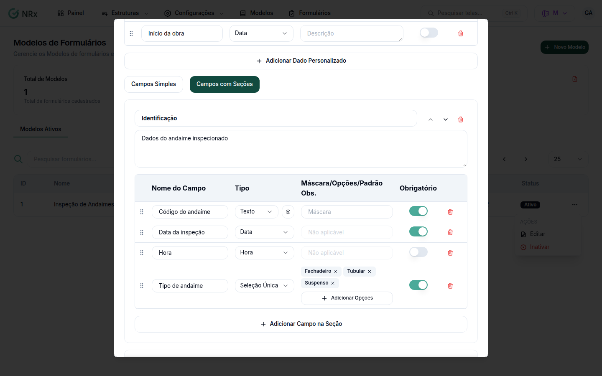

# Adicionar campos ao modelo

**Para que serve:** definir o que a equipe preenche em cada registro do formulário.


**Quem pode fazer:** Gestor ou Administrador, com a permissão de criar ou editar modelos de formulário.


## Antes de começar

* Abra o modelo em **Novo Modelo** ou em **Editar**.

## Passo a passo



### Adicione o campo

Clique em **Adicionar Campo**. Informe o **Nome do Campo** e escolha o **Tipo** (veja [Escolher o tipo de campo](tipos-de-campos.md)).

<figure><figcaption>
Campos do modelo
</figcaption></figure>



### Complete

Em **Máscara/Opções/Padrão Obs.**, informe a máscara ou as opções, conforme o tipo. Para **Seleção Única** e **Seleção Múltipla**, use **Adicionar Opções**. Ligue **Obrigatório** se o campo não pode ficar vazio.



### Salve

Clique em **Salvar Modelo**.



## Dúvidas comuns

A máscara aparece como "Não aplicável".

O tipo escolhido não aceita máscara.

Como agrupo os campos?

Veja [Organizar os campos em seções](secoes-e-organizacao.md).

