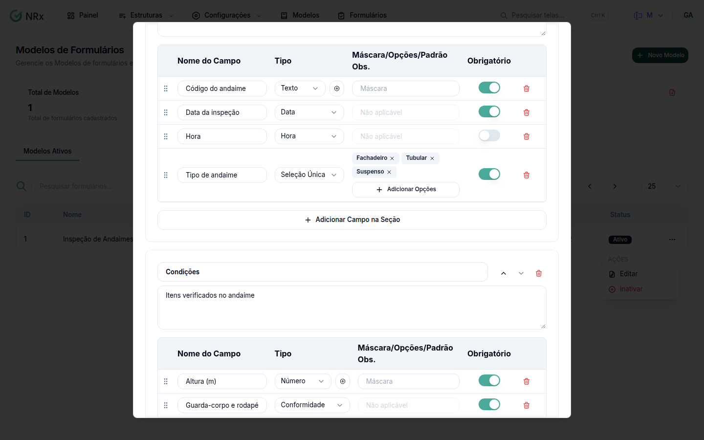

# Organizar os campos em seções

**Para que serve:** separar os campos em blocos com título. Ex.: "Dados do extintor" e "Inspeção".


**Quem pode fazer:** Gestor ou Administrador, com a permissão de criar ou editar modelos de formulário.


## Antes de começar

* Abra o modelo em **Novo Modelo** ou em **Editar**.

## Passo a passo



### Use seções

Escolha **Campos com Seções** e clique em **Adicionar Seção**. Informe o **Título da Seção** e, se quiser, a **Descrição da seção**.

<figure><figcaption>
Seções do modelo
</figcaption></figure>



### Adicione os campos da seção

Clique em **Adicionar Campo na Seção** e preencha como em [Adicionar campos ao modelo](editor-de-campos.md). Clique em **Salvar Modelo**.



## Dúvidas comuns

Preciso de seções?

Não. Para um formulário curto, use **Campos Simples**.

Onde vejo a seção no formulário?

Ao abrir o formulário, cada seção aparece com os seus registros.

