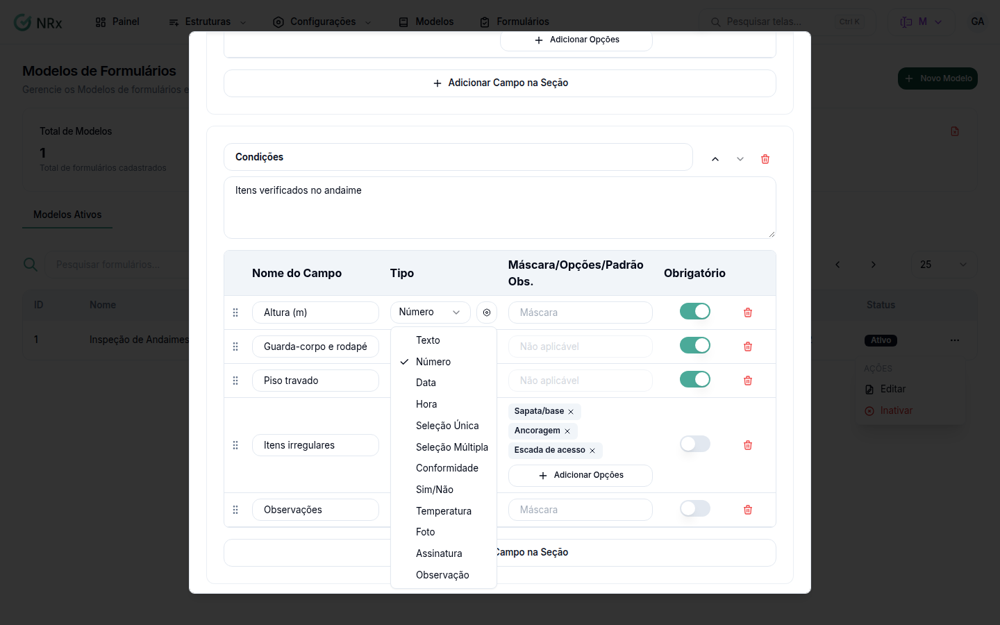

# Escolher o tipo de campo

**Para que serve:** escolher o tipo certo para cada campo do modelo.


**Quem pode fazer:** Gestor ou Administrador, com a permissão de criar ou editar modelos de formulário.


## Antes de começar

* Veja [Adicionar campos ao modelo](editor-de-campos.md).

## Passo a passo



### Escolha o tipo

Em **Tipo**, escolha:

| Tipo | Para quê |
| --- | --- |
| **Texto** | Texto livre. |
| **Número** | Valores numéricos. |
| **Data** e **Hora** | Datas e horários. |
| **Seleção Única** | Uma opção de uma lista. |
| **Seleção Múltipla** | Várias opções de uma lista. |
| **Conformidade** | Conforme ou não conforme. |
| **Sim/Não** | Resposta sim ou não. |
| **Temperatura** | Medições de temperatura. |
| **Foto** | Imagem PNG ou JPG, até 10 MB. |
| **Assinatura** | Assinatura desenhada na tela. |
| **Observação** | Texto de observação (não pode ser obrigatório). |

<figure><figcaption>
Tipos de campo
</figcaption></figure>



## Dúvidas comuns

Posso limitar um número?

Pode. Veja [Configurar validação e máscara](validacoes-e-mascaras.md).

A foto não sobe.

Envie só imagens, até 10 MB. Aparece "O tamanho máximo permitido é 10MB" se passar do limite.

