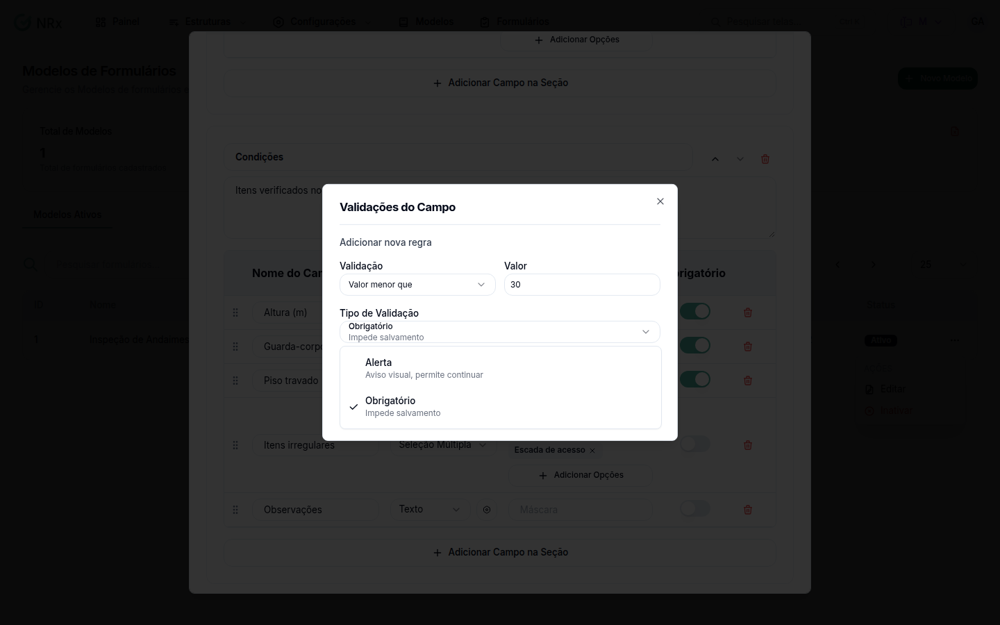

# Configurar validação e máscara de um campo

**Para que serve:** avisar ou impedir quando um valor sai do esperado (ex.: temperatura acima de 8) e padronizar o formato do campo.


**Quem pode fazer:** Gestor ou Administrador, com a permissão de criar ou editar modelos de formulário.


## Antes de começar

* O campo precisa estar no modelo. Veja [Adicionar campos ao modelo](editor-de-campos.md).

## Passo a passo



### Abra as validações do campo

No campo, abra **Validações do Campo** e clique em **Adicionar nova regra**.

<figure><figcaption>
Validações do Campo
</figcaption></figure>



### Defina a regra

Em **Validação**, escolha **Valor maior que** ou **Valor menor que** e informe o **Valor**. Em **Tipo de Validação**, escolha o nível: **Alerta** (aviso visual, permite continuar) ou **Obrigatório** (impede salvamento). Clique em **Adicionar**.



### Defina a máscara (se quiser)

Em **Máscara/Opções/Padrão Obs.**, informe a máscara do campo. Clique em **Salvar Modelo**.



## Dúvidas comuns

Posso pôr dois limites?

Pode: um **Valor maior que** e um **Valor menor que** no mesmo campo, cada um uma vez.

O que a equipe vê?

Com **Alerta**, um aviso e o registro é salvo. Com **Obrigatório**, o registro não é salvo até corrigir.

