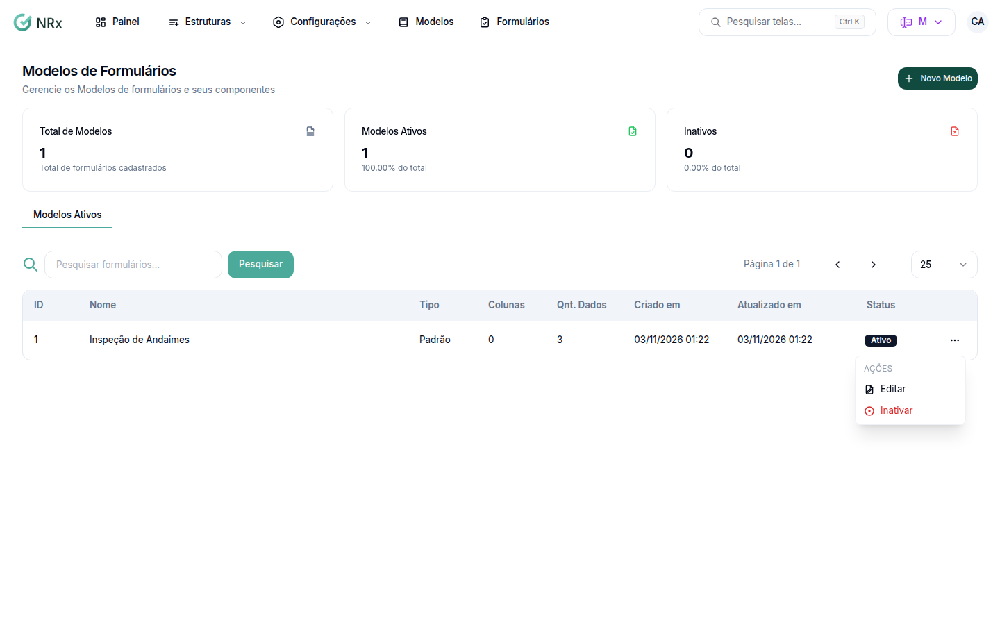

# Editar, revisar ou inativar um modelo

**Para que serve:** mudar campos e dados do modelo, registrar uma nova revisão ou tirar o modelo de uso.


**Quem pode fazer:** Gestor ou Administrador. Editar exige a permissão de editar modelos de formulário; inativar, a de deletar modelos de formulário.


## Antes de começar

* Nada a preparar.

## Passo a passo



### Edite

Em **Modelos de Formulário**, abra o menu da linha (**Ações**) e clique em **Editar**. Em **Editar Modelo de Formulário**, altere o que precisar e atualize o **Nº Revisão** e a **Data da Revisão**. Salve. Aparece "Modelo atualizado com sucesso".

<figure><figcaption>
Modelos de Formulários
</figcaption></figure>



### Inative ou ative

No menu **Ações**, clique em **Inativar** e confirme em **Sim, inativar modelo**. Para voltar, use **Ativar** e **Sim, Ativar modelo**.



## Dúvidas comuns

Onde vejo os modelos inativos?

No topo de **Modelos de Formulário**, em **Inativos**. Na lista, a coluna **Status** mostra a situação.

Como encontro um modelo?

Use **Pesquisar formulários...** e ajuste as **Colunas Visíveis**.

