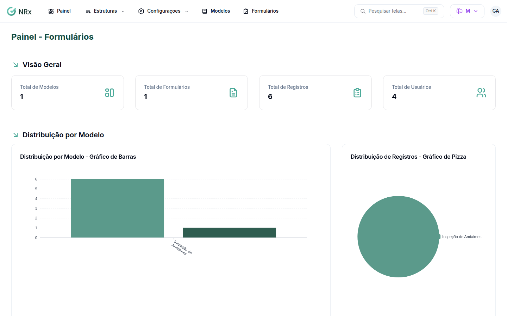

# Ver o painel de Formulários

**Para que serve:** ver quantos modelos, formulários e registros a empresa tem e como eles se distribuem por modelo, unidade e período.


**Quem pode fazer:** Supervisor, Gestor ou Administrador, com a permissão de ver o painel de Formulários.


## Antes de começar

* Nada a preparar.

## Passo a passo



### Abra o painel

Clique em **Painel**. A **Visão Geral** mostra o **Total de Modelos**, o **Total de Formulários**, o **Total de Registros** e o **Total de Usuários**, além dos **Últimos Formulários** e dos **Últimos Registros**.

<figure><figcaption>
Painel - Formulários
</figcaption></figure>



### Filtre o período

Em **Análise de Formulários e Registros**, escolha a **Data Inicial**, a **Data Final** (ou um atalho como **Últimos 30 dias**) e a **Unidade**. Clique em **Filtrar**.



## Deu errado?

| Mensagem na tela | O que fazer |
| --- | --- |
| "O período máximo permitido é de 1 ano" | Diminua o período. |
| "Data final deve ser maior ou igual à data inicial" | Ajuste as datas. |
| "Você não possui permissão para visualizar o painel" | Peça a permissão a um Administrador. |

## Dúvidas comuns

Onde vejo por modelo e por unidade?

Em **Distribuição por Modelo** e **Distribuição por Unidade**.

Quero o relatório de um formulário só.

Veja [Montar um relatório do formulário](relatorios/relatorio-por-formulario.md).

