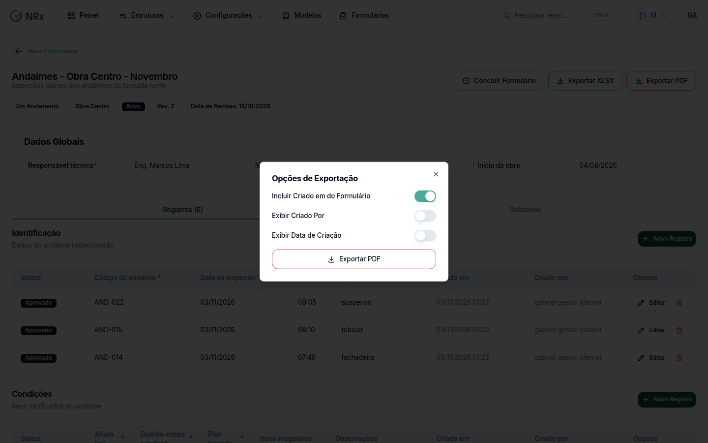

# Exportar um formulário

**Para que serve:** baixar os registros de um formulário em Excel ou PDF.


**Quem pode fazer:** Gestor ou Administrador, com a permissão de gerar relatórios de formulários em Excel ou em PDF.


## Antes de começar

* Abra o formulário em **Meus Formulários**.

## Passo a passo



### Escolha o formato

No formulário, clique em **Exportar XLSX** ou em **Exportar PDF**.

<figure><figcaption>
Exportar PDF
</figcaption></figure>



### Ajuste o PDF (se for PDF)

Em **Opções de Exportação**, marque o que quer: **Incluir Criado em do Formulário**, **Exibir Criado Por**, **Exibir Data de Criação**. Confirme.



## Deu errado?


**"Não foi possível exportar os dados"**: tente de novo.


## Dúvidas comuns

Não vejo os botões de exportar.

Eles só aparecem para quem tem a permissão de gerar relatórios de formulários.

Quero vários formulários de uma vez.

Veja [Emitir vários formulários em um PDF](relatorio-consolidado.md).

