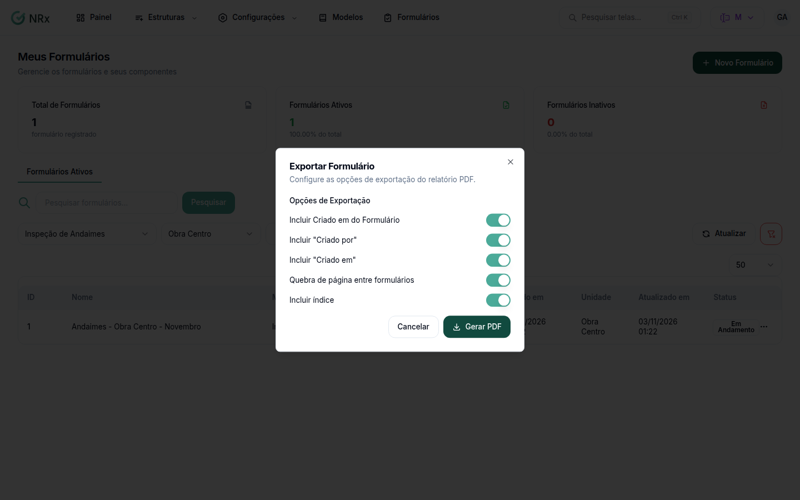

# Emitir vários formulários em um PDF

**Para que serve:** gerar um PDF único com os formulários de um modelo, numa unidade e num período.


**Quem pode fazer:** Gestor ou Administrador, com a permissão de gerar relatórios de formulários em PDF.


## Antes de começar

* Em **Meus Formulários**, filtre o **Modelo**, a **Unidade** e o período.

## Passo a passo



### Abra a emissão

Clique em **Emissão em Massa**.

<figure><figcaption>
Exportar Formulário
</figcaption></figure>



### Gere

Em **Opções de Exportação**, marque o que quer: **Incluir "Criado por"**, **Incluir "Criado em"**, **Quebra de página entre formulários** e **Incluir índice**. Clique em **Gerar PDF**. Aparece "Relatório gerado com sucesso".



## Deu errado?

| Mensagem na tela | O que fazer |
| --- | --- |
| **Emissão em Massa** apagado | Filtre o **Modelo** e a **Unidade**. |
| "Selecione uma data de início e fim" | Escolha o período. |

## Dúvidas comuns

Só um formulário?

Veja [Exportar um formulário](exportacao-de-dados.md).

Posso juntar modelos diferentes?

Não. A emissão é de um modelo por vez.

