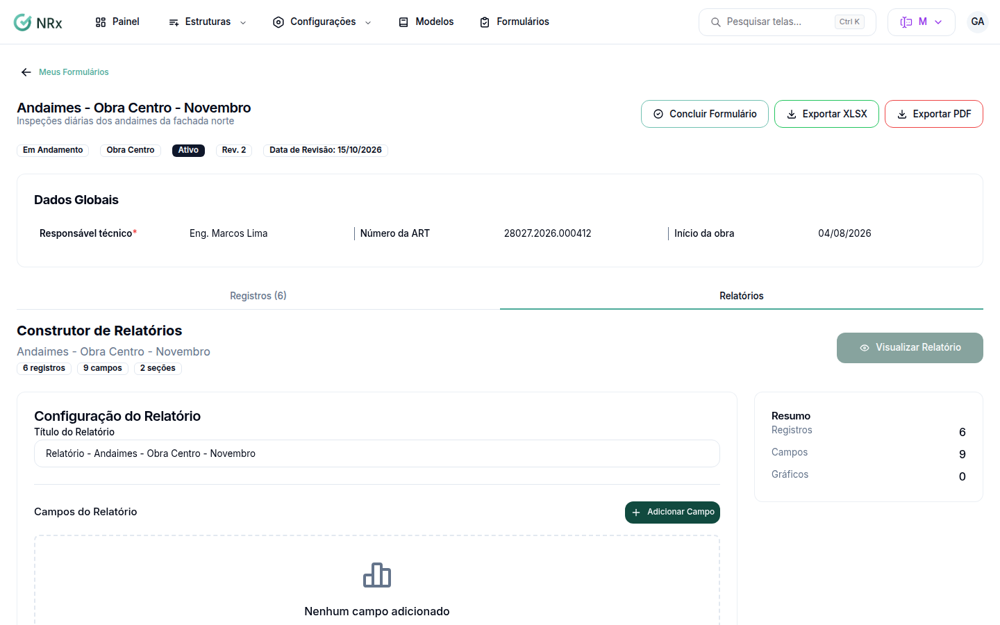

# Montar um relatório do formulário

**Para que serve:** escolher campos de um formulário e ver resumo, registros e gráficos. Ex.: média de temperatura por câmara.


**Quem pode fazer:** Supervisor, Gestor ou Administrador, com a permissão de ver o painel de Formulários.


## Antes de começar

* O formulário precisa ter registros.

## Passo a passo



### Abra o construtor

Abra o formulário e clique em **Relatórios**. Abre o **Construtor de Relatórios**.

<figure><figcaption>
Construtor de Relatórios
</figcaption></figure>



### Escolha os campos

Informe o **Título do Relatório**. Em **Campos do Relatório**, clique em **Adicionar Campo** e escolha o **Campo**, a **Agregação** e a **Visualização**.



### Veja

Clique em **Visualizar Relatório**. Veja o **Resumo**, os **Registros** e os **Gráficos**. Para baixar, use **Excel** ou **PDF**.



## Dúvidas comuns

Posso guardar a configuração?

Pode. Clique em **Salvar Configuração**, dê um **Título** e salve. Depois, em **Relatórios Salvos**, use **Carregar**.

Apareceu "Não há registros suficientes para gerar este gráfico."

Lance mais registros ou escolha outro campo.

