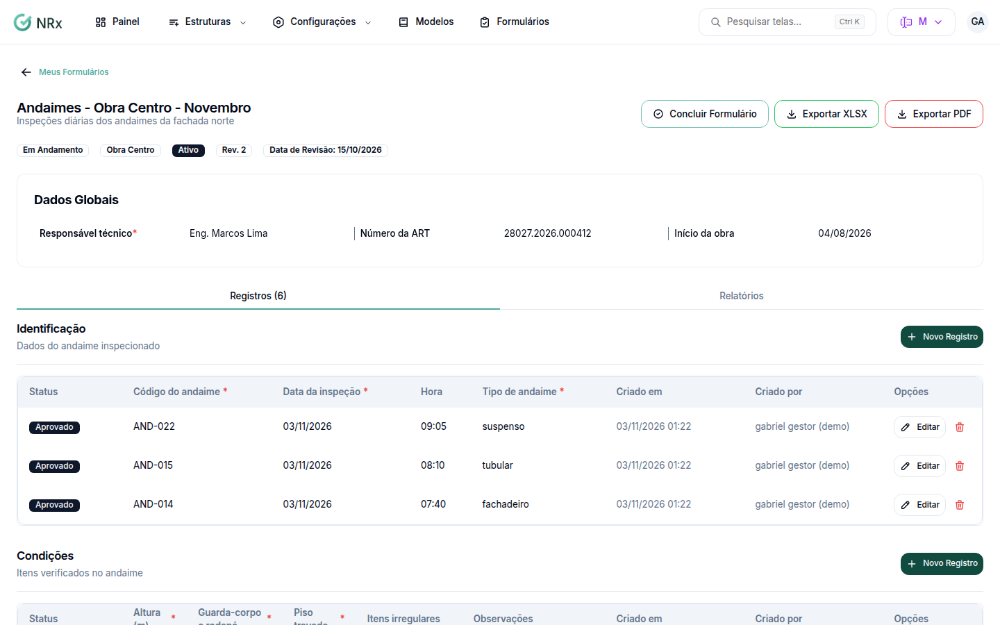

# Lançar os registros de um formulário

**Para que serve:** preencher o formulário: cada registro é uma linha (ex.: um extintor inspecionado).


**Quem pode fazer:** todas as roles. Lançar exige a permissão de preencher registros; concluir e reabrir, a de editar formulários.


## Antes de começar

* O formulário precisa estar **Em Andamento**.

## Passo a passo



### Lance o registro

Abra o formulário e clique em **Novo Registro**. Preencha os campos e clique em **Salvar**. Aparece "Registro criado com sucesso!".

<figure><figcaption>
Registros do formulário
</figcaption></figure>



### Edite ou exclua

Na linha, em **Opções**, use **Editar** (aparece "Registro atualizado com sucesso!") ou **Excluir** (não pode ser desfeito).



### Conclua

Clique em **Concluir Formulário** e confirme em **Sim, concluir formulário**. Depois de concluído, não é possível fazer alterações.



## Deu errado?

| Mensagem na tela | O que fazer |
| --- | --- |
| "Valor não é um número válido" | Digite só números. |
| "Use o formato YYYY-MM-DD" / "Use o formato HH:MM" | Ajuste a data ou a hora. |
| "Corrija os dados obrigatórios primeiro" | Preencha os dados obrigatórios antes de concluir. |

## Dúvidas comuns

Tem registros em rascunho e não consigo concluir.

Use **Excluir rascunhos e concluir**. Os rascunhos são excluídos.

Preciso mexer num formulário concluído.

Clique em **Reabrir Formulário**. Ele volta para **Em andamento**.

