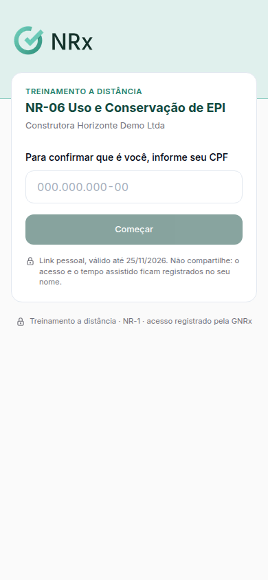

# Fazer o curso pelo link

**Para que serve:** fazer o treinamento a distância pelo link que chegou por e-mail ou WhatsApp. O link cobre o curso inteiro, sem login: módulos, progresso e prova.


**Quem pode fazer:** o colaborador que recebeu o link.


## Antes de começar

* Abra o link no celular ou no computador.

## Passo a passo



### Confirme o CPF

Abre **Treinamento a distância**. Digite o seu **CPF** para confirmar que é você. Toque em **Começar**.

<figure><figcaption>
Confirmar o CPF
</figcaption></figure>



### Faça os módulos e a prova

Assista os módulos na ordem e faça a prova, se tiver. Funciona igual ao [curso no portal](fazer-um-curso.md).



### Pronto

Aparece **Parabéns, treinamento concluído**.



## Deu errado?

| Mensagem na tela | O que fazer |
| --- | --- |
| "Link inválido." | Confira o endereço ou peça um novo link ao responsável pelo treinamento. |
| "Link indisponível" | Peça um novo link ao responsável pelo treinamento. |
| "Treinamento indisponível" | Fale com o responsável pelo treinamento. |

## Dúvidas comuns

Recebi dois links. Qual uso?

O mais novo. Um envio novo substitui o link anterior.

Preciso do PIN?

Não. No link, só o CPF. A única coisa que não dá para fazer pelo link é a [avaliação do treinamento](responder-reacao.md), que é no aplicativo.

