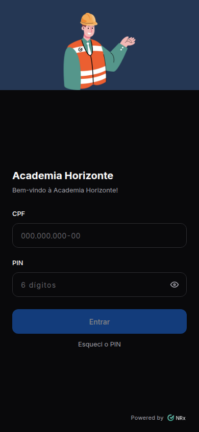

# Entrar no portal de cursos

**Para que serve:** abrir os seus cursos no celular ou no computador.


**Quem pode fazer:** o colaborador que a empresa liberou para os cursos.


## Antes de começar

* Tenha o endereço do portal. A empresa passa no cartaz ou por mensagem.
* Tenha o seu PIN de 6 números. É o mesmo do app GNRx Colaborador.

## Passo a passo



### Abra o portal

Abra o endereço do portal no navegador do celular. Ou aponte a câmera para o QR Code do cartaz.

<figure><figcaption>
Tela de entrada
</figcaption></figure>



### Digite CPF e PIN

Digite o **CPF** e o **PIN**. Toque em **Entrar**.



### Pronto

Abre o **Início**, com os seus cursos.

<figure><figcaption>
Início
</figcaption></figure>



## Deu errado?

| Mensagem na tela | O que fazer |
| --- | --- |
| "Confira o CPF e o PIN." | Digite de novo, com calma. Toque no olho para ver o PIN. |
| "Não foi possível entrar. Confira a internet e tente de novo." | Veja se o celular está com internet e tente de novo. |
| "Nenhum curso liberado para você ainda" | A empresa ainda não liberou curso para você. Aguarde ou fale com o RH. |

## Dúvidas comuns

Esqueci o PIN.

Toque em **Esqueci o PIN**. Para trocar, peça ao responsável pelo portal na sua empresa.

Posso usar no computador?

Pode. O portal abre no navegador do computador e do celular.

