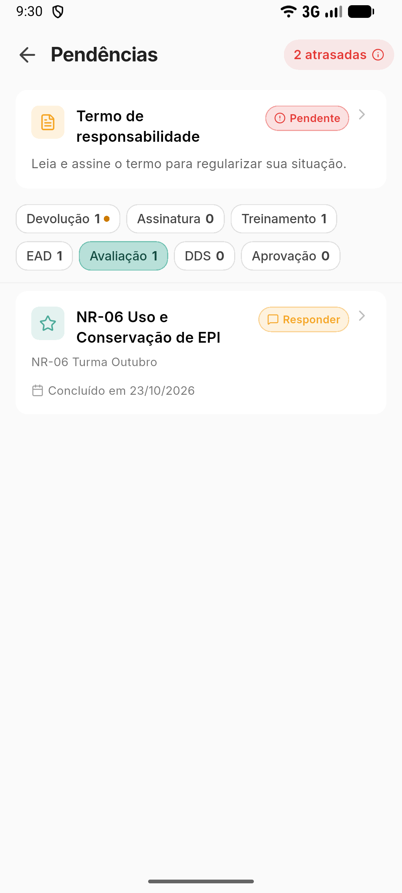
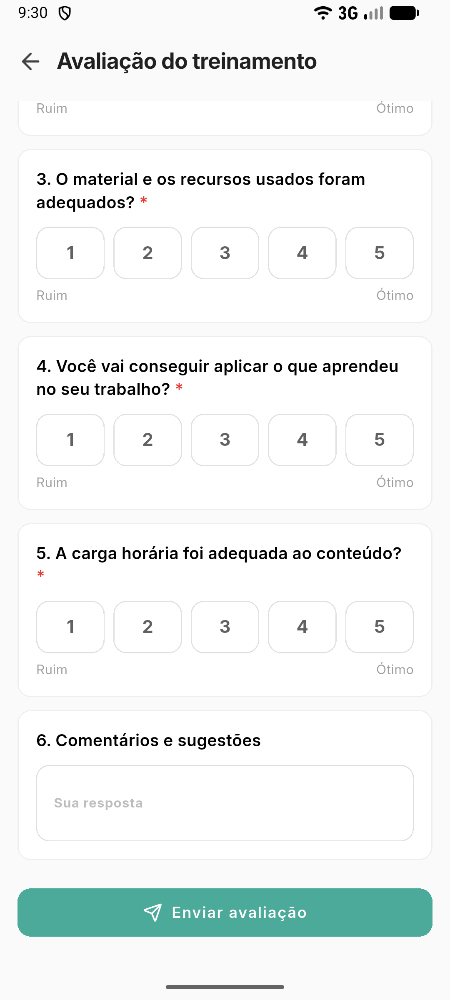

# Responder a avaliação do treinamento

**Para que serve:** dizer o que você achou do treinamento que concluiu. As respostas são anônimas.


**Quem pode fazer:** o colaborador aprovado, depois que a turma é concluída. A avaliação é respondida no **aplicativo GNRx Colaborador**, não no portal de cursos.


## Antes de começar

* Tenha o aplicativo GNRx Colaborador no celular. Você entra com o CPF e o PIN.

## Passo a passo



### Abra as pendências

No aplicativo, abra **Pendências › Avaliação**. Cada treinamento aparece com "Concluído em" e a data.

<figure><figcaption>
Pendências › Avaliação
</figcaption></figure>



### Toque em Responder

Toque em **Responder**. Abre **Avaliação do treinamento**.



### Responda

Responda cada pergunta: dê a nota, de **Ruim** a **Ótimo**, ou escreva em **Sua resposta**. As perguntas com "Resposta obrigatória" precisam de resposta.

<figure><figcaption>
Avaliação do treinamento
</figcaption></figure>



### Envie

Toque em **Enviar avaliação**. Aparece "Avaliação enviada. Obrigado!".



## Deu errado?

| Mensagem na tela | O que fazer |
| --- | --- |
| "Falta responder 1 pergunta obrigatória." | Responda a pergunta marcada e envie de novo. |
| "Esta avaliação já foi respondida." | Você já respondeu. Não precisa fazer nada. |
| "Não foi possível enviar a avaliação." | Confira a internet e toque em **Tentar de novo**. |
| "Não foi possível abrir a avaliação." | Confira a internet e tente de novo. |

## Dúvidas comuns

A empresa vê o meu nome?

Não. As respostas são anônimas.

A avaliação tem prazo?

Não. Ela fica nas suas pendências até você responder.

