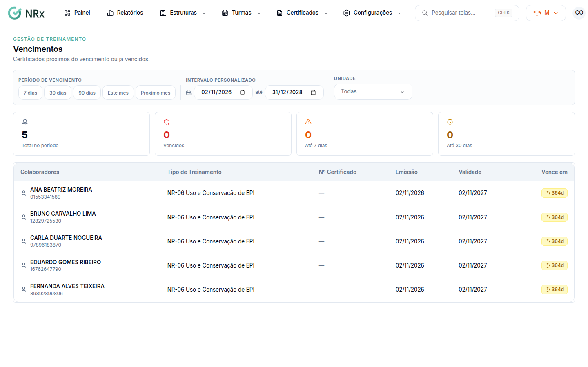

# Acompanhar os vencimentos

**Para que serve:** ver os certificados próximos do vencimento ou já vencidos, por unidade ou colaborador.


**Quem pode fazer:** Gestor ou Administrador, com a permissão de filtrar vencimentos.


## Antes de começar

* Nada a preparar.

## Passo a passo



### Abra os vencimentos

Clique em **Certificados › Vencimentos**. O topo mostra **Total no período**, **Até 7 dias** e **Até 30 dias**.

<figure><figcaption>
Vencimentos
</figcaption></figure>



### Escolha o período

Em **Período de vencimento**, escolha **Este mês**, **Próximo mês** ou **Intervalo personalizado**. Use **Filtros** para refinar.



## Dúvidas comuns

Apareceu "Nenhum resultado encontrado".

Tente ajustar os filtros ou ampliar o período de vencimento.

Como renovo um certificado vencendo?

[Programe uma turma](../turmas/programar-treinamento.md) do mesmo treinamento.

