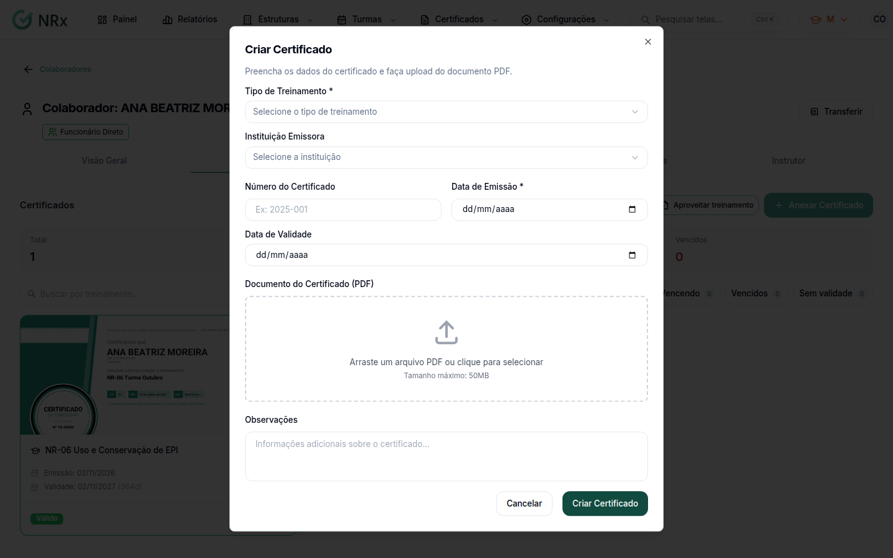

# Anexar um certificado

**Para que serve:** cadastrar um certificado feito fora do GNRx, como um curso externo.


**Quem pode fazer:** Supervisor, Gestor ou Administrador, com a permissão de anexar certificado ao colaborador.


## Antes de começar

* Tenha o PDF do certificado (até 50MB).
* O tipo de treinamento precisa estar no catálogo.

## Passo a passo



### Abra o colaborador

Clique em **Estruturas › Colaboradores** e abra o colaborador. Na aba **Certificados**, clique em **Anexar Certificado**. A lista do menu **Certificados** não tem botão de criar: o anexo é feito na ficha do colaborador.



### Preencha

Em **Novo Certificado**, escolha o **Tipo de Treinamento** e a **Instituição Emissora**. Preencha o **Número do Certificado** (ex.: 2025-001), a **Data de Emissão** e a **Data de Validade**. Envie o **Documento do Certificado (PDF)**.

<figure><figcaption>
Novo Certificado
</figcaption></figure>



### Crie

Clique em **Criar Certificado**. Aparece "Certificado criado com sucesso".



## Deu errado?

| Mensagem na tela | O que fazer |
| --- | --- |
| "Selecione um tipo de treinamento" | Escolha o tipo. |
| "Data de emissão é obrigatória" | Preencha a data de emissão. |
| "A data de validade não pode ser anterior à data de emissão" | Confira as datas. |
| "Apenas arquivos PDF são permitidos." | Envie o certificado em PDF. |
| "O arquivo deve ter no máximo 50MB." | Use um arquivo menor. |

## Dúvidas comuns

A instituição não aparece.

Cadastre em **Configurações › Instituições Certificadoras**.

E para o instrutor?

No instrutor, a aba **Qualificações** usa o mesmo cadastro de certificado.

