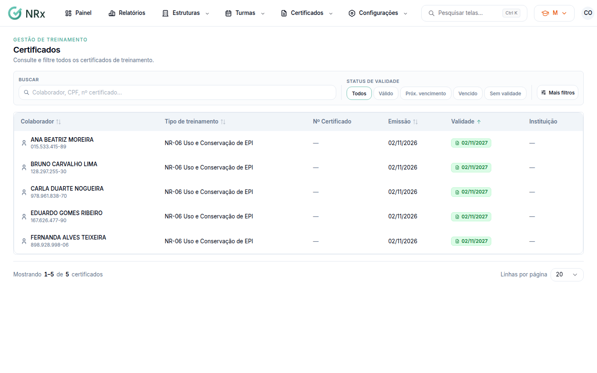

# Consultar os certificados

**Para que serve:** achar um certificado por colaborador, CPF ou número, e ver a validade.


**Quem pode fazer:** todas as roles (Operador, Supervisor, Gestor e Administrador), com a permissão de ver certificados.


## Antes de começar

* Nada a preparar.

## Passo a passo



### Abra a lista

Clique em **Certificados › Certificados**.

<figure><figcaption>
Certificados
</figcaption></figure>



### Busque e filtre

Digite o colaborador, o CPF ou o número do certificado e clique em **Buscar**. Use o **Status de validade**. Em **Filtros avançados**, escolha **Tipo de treinamento**, **Unidade**, **Data de emissão** e **Data de validade**.



## Dúvidas comuns

Apareceu "Nenhum certificado encontrado".

Tente ajustar os filtros de busca. Clique em **Limpar**.

Como vejo os certificados de uma pessoa?

No cadastro do colaborador, na parte **Certificados**.

