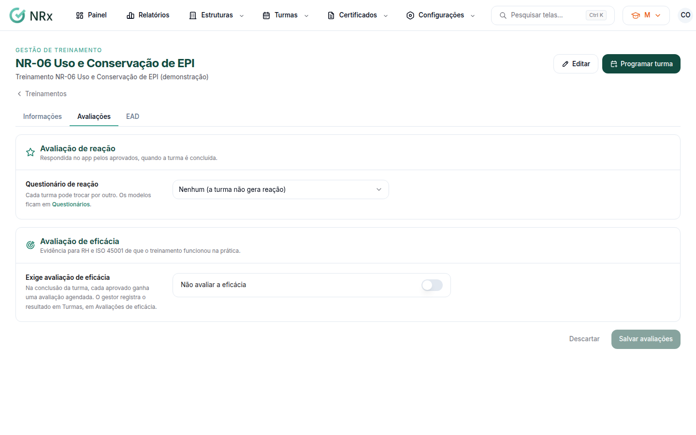

# Definir as avaliações de um treinamento

**Para que serve:** escolher o questionário de reação padrão e se o treinamento exige avaliação de eficácia.


**Quem pode fazer:** Gestor ou Administrador, com a permissão de editar treinamentos.


## Antes de começar

* [Crie o questionário de reação](questionarios.md), se não for usar um padrão.

## Passo a passo



### Abra o treinamento

Clique em **Configurações › Tipos de Treinamentos**, abra o treinamento e vá à aba **Avaliações**.

<figure><figcaption>
Aba Avaliações
</figcaption></figure>



### Escolha a reação

Em **Questionário de reação**, escolha o questionário ou **Nenhum (a turma não gera reação)**.



### Escolha a eficácia

Em **Exige avaliação de eficácia**, escolha **Avaliar a eficácia de cada aprovado** ou **Não avaliar a eficácia**. Informe os **Dias depois do fim da turma**.



### Salve

Clique em **Salvar avaliações**. Aparece "Avaliações do treinamento salvas.".



## Dúvidas comuns

O que acontece no dia da avaliação de eficácia?

Cada aprovado ganha uma avaliação agendada. Os gestores da unidade recebem um e-mail. O resultado é registrado em [Avaliar a eficácia](../turmas/avaliar-eficacia.md).

Posso usar outra reação numa turma?

Pode. Na turma, aba **Reação**. Veja [Ver a reação dos participantes](../turmas/reacao.md).

