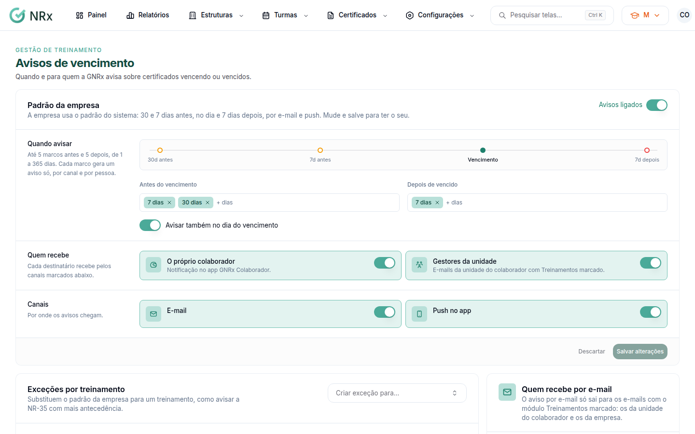

# Configurar os avisos de vencimento

**Para que serve:** definir quando e para quem o GNRx avisa sobre certificados vencendo ou vencidos.


**Quem pode fazer:** Supervisor, Gestor ou Administrador, com a permissão de configurar alertas de vencimento.


## Antes de começar

* Sem configuração, vale o padrão do sistema: 30 e 7 dias antes, no dia e 7 dias depois, por e-mail e push.

## Passo a passo



### Abra os avisos

Clique em **Configurações › Avisos de vencimento**. Em **Padrão da empresa** fica o que vale para todo treinamento sem exceção própria.

<figure><figcaption>
Avisos de vencimento
</figcaption></figure>



### Diga quando avisar

Em **Quando avisar**, digite os dias **Antes do vencimento** e **Depois de vencido** e tecle Enter. São até 5 marcos antes e 5 depois, de 1 a 365 dias. Se quiser, ligue **Avisar também no dia do vencimento**.



### Diga quem recebe

Em **Quem recebe**, marque **O próprio colaborador** (notificação no app GNRx Colaborador) e **Gestores da unidade** (e-mails da unidade do colaborador com Treinamentos marcado). Escolha os canais: e-mail e **Push no app**.



### Salve

Clique em **Salvar alterações**. Aparece "Avisos salvos.".




**Quem recebe por e-mail:** em **E-mails da empresa**, digite o e-mail (ex.: sesmt@empresa.com.br) e clique em **Adicionar**. Em **E-mails das unidades**, use **Abrir as unidades**. Unidade sem e-mail de Treinamentos usa os e-mails da empresa. Sem nenhum dos dois, os avisos dessas unidades não saem por e-mail.


## Dúvidas comuns

Um treinamento precisa de avisos diferentes.

Em **Exceções por treinamento**, use **Criar exceção para…** e escolha o treinamento. Para desfazer, clique em **Voltar ao padrão**.

Posso desligar os avisos de um treinamento?

Pode. Na exceção do treinamento, desligue os avisos. Aparece "Avisos desligados para este treinamento".

