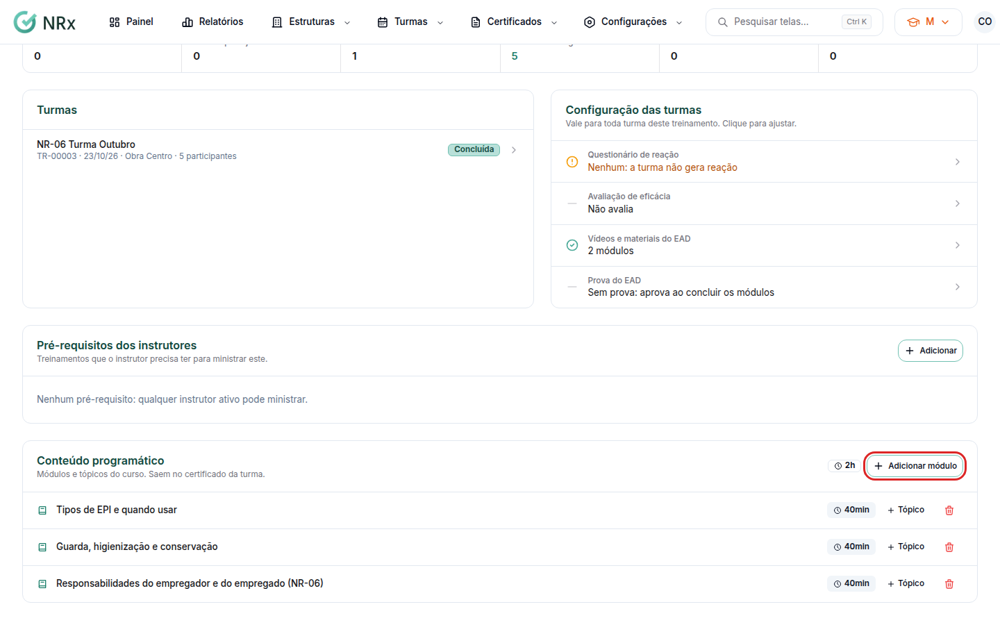

# Cadastrar o conteúdo programático

**Para que serve:** cadastrar os módulos e tópicos do treinamento. Eles saem no certificado da turma.


**Quem pode fazer:** Gestor ou Administrador, com a permissão de editar treinamentos.


## Antes de começar

* [Cadastre o tipo de treinamento](tipos-de-treinamento.md).

## Passo a passo



### Abra o treinamento

Clique em **Configurações › Tipos de Treinamentos** e abra o treinamento. Na aba **Informações**, vá a **Conteúdo programático**.

<figure><figcaption>
Conteúdo programático
</figcaption></figure>



### Adicione módulos e tópicos

Clique em **Adicionar módulo**. Preencha o **Título** (ex.: Módulo 1 - Introdução) e, se quiser, a **Carga Horária (minutos)**. Dentro do módulo, adicione os tópicos (ex.: Conceitos básicos de segurança).



## Deu errado?


**"O título é obrigatório."**: preencha o título.


## Dúvidas comuns

Como removo um módulo?

Use remover e confirme em **Remover Item**. O módulo e todos os seus tópicos são removidos.

Por que o curso EAD pede o conteúdo programático?

Porque ele vai no certificado. Sem ele, o curso não pode ser publicado.

