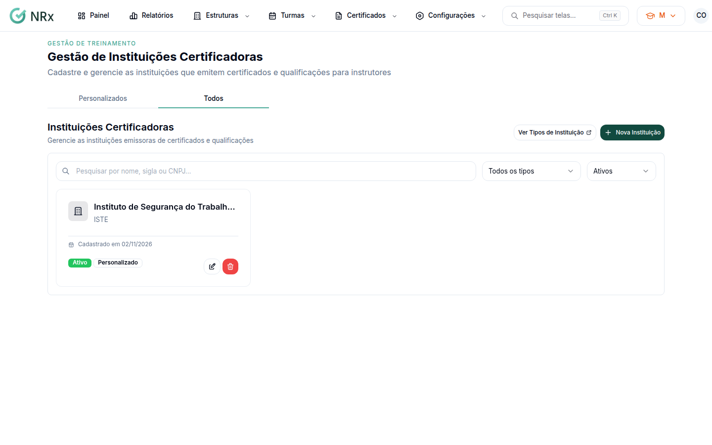

# Cadastrar uma instituição certificadora

**Para que serve:** cadastrar quem emite certificados (ex.: SENAI), para usar ao anexar certificados.


**Quem pode fazer:** Gestor ou Administrador, com a permissão de criar instituições certificadoras. Para inativar: Administrador.


## Antes de começar

* Tenha o nome, a sigla e o CNPJ da instituição.

## Passo a passo



### Abra as instituições

Clique em **Configurações › Instituições Certificadoras**. Use **Pesquisar por nome, sigla ou CNPJ...**.

<figure><figcaption>
Instituições Certificadoras
</figcaption></figure>



### Clique em Nova Instituição

Clique em **Nova Instituição**. Preencha o nome (ex.: SENAI - Serviço Nacional de Aprendizagem Industrial), a **Sigla**, o **Tipo de Instituição**, o **CNPJ** (só números), o **Website** e as **Observações**.



### Salve

Salve. Aparece "Instituição certificadora criada com sucesso!".



## Deu errado?

| Mensagem na tela | O que fazer |
| --- | --- |
| "CNPJ deve conter 14 dígitos numéricos" | Digite só os 14 números. |
| "URL inválida" | Confira o site (ex.: https://exemplo.com.br). |

## Dúvidas comuns

O tipo de instituição que preciso não existe.

Clique em **Ver Tipos de Instituição** e depois em **Novo Tipo**.

Como tiro uma instituição da lista?

No cartão, inative e confirme em **Inativar Instituição**. "A instituição não aparecerá mais na lista."

