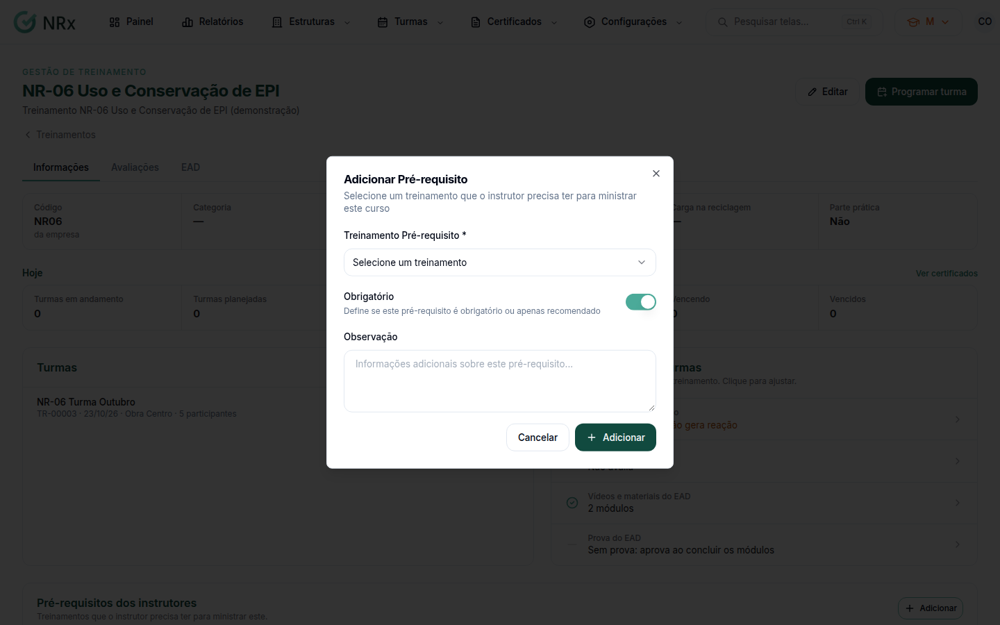

# Definir os pré-requisitos do instrutor

**Para que serve:** registrar quais treinamentos o instrutor deve ter para ministrar este. É uma referência para quem monta as turmas.


**Quem pode fazer:** qualquer usuário com o módulo Treinamentos que abre o treinamento no catálogo.



O GNRx não confere isso sozinho: ao escolher o instrutor da turma, verifique você mesmo se ele tem esses certificados, nas [qualificações do instrutor](../estruturas/instrutores/editar-instrutor.md).


## Antes de começar

* Os treinamentos de pré-requisito precisam estar no catálogo.

## Passo a passo



### Abra o treinamento

Clique em **Configurações › Tipos de Treinamentos** e abra o treinamento. Na aba **Informações**, vá a **Pré-requisitos dos instrutores**.



### Adicione

Clique em **Adicionar Pré-requisito**. Escolha o **Treinamento Pré-requisito**, marque **Obrigatório** (ou deixe como recomendado) e, se quiser, escreva uma **Observação**. Clique em **Adicionar**. Aparece "Pré-requisito adicionado com sucesso!".

<figure><figcaption>
Adicionar Pré-requisito
</figcaption></figure>



## Deu errado?


**"Selecione um treinamento"**: escolha o treinamento de pré-requisito.


## Dúvidas comuns

Qual a diferença entre obrigatório e recomendado?

Marcado como **Obrigatório**, a lista mostra **Sim**. Desmarcado, mostra **Recomendado**.

Como removo?

Use remover e confirme em **Remover Pré-requisito**.

