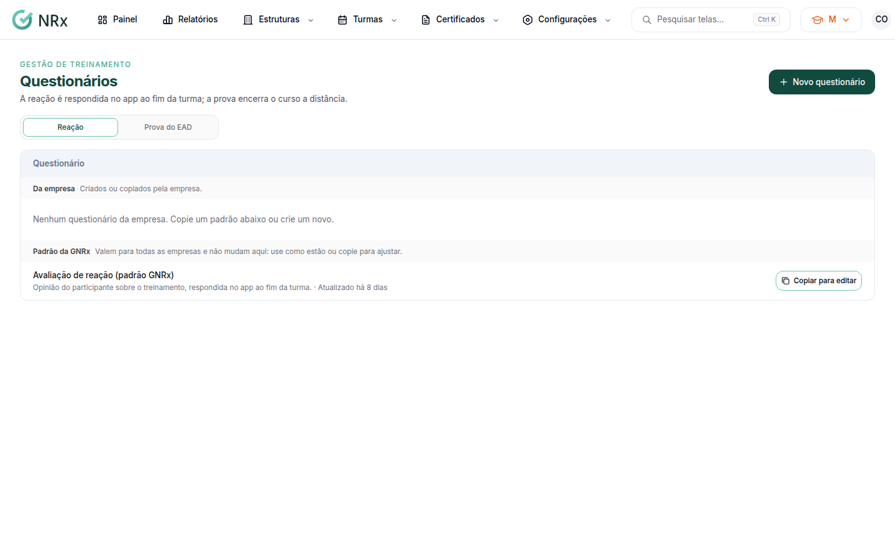
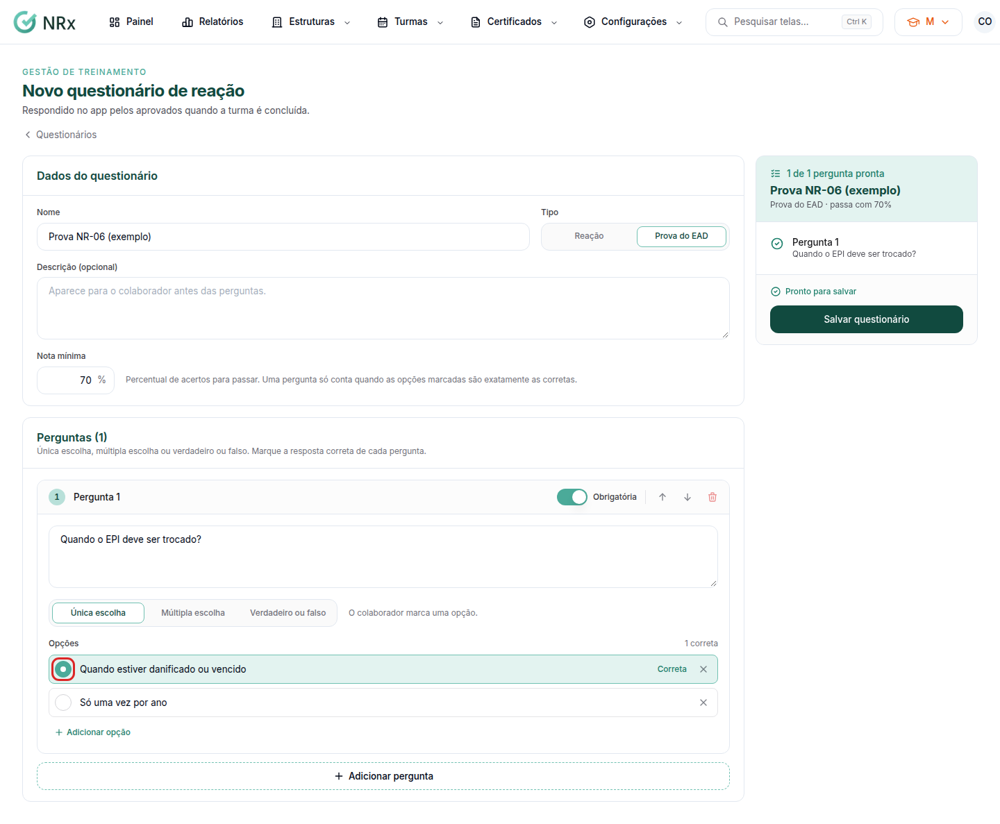

# Criar um questionário

**Para que serve:** criar a prova de um curso EAD ou o questionário de reação que os aprovados respondem no app.


**Quem pode fazer:** Supervisor, Gestor ou Administrador, com a permissão de gerenciar questionários.


## Antes de começar

* Veja se um **Padrão da GNRx** já serve. Ele pode ser usado como está ou copiado.

## Passo a passo



### Comece o questionário

Clique em **Configurações › Questionários**. Clique em **Novo questionário** e escolha o **Tipo de questionário**: prova do EAD ou reação. O tipo não muda depois de criado. Ou, num padrão da GNRx, clique em **Fazer uma cópia** e depois em **Criar cópia**.

<figure><figcaption>
Questionários
</figcaption></figure>



### Preencha os dados

Dê um nome (ex.: Prova NR-35 Trabalho em Altura) e, se quiser, uma descrição. Na prova, informe a **Nota mínima**.



### Escreva as perguntas

Clique em **Adicionar pergunta**. Na prova, use única escolha, múltipla escolha ou verdadeiro ou falso, e marque a **Resposta correta**. Na reação, use a escala de 1 a 5 (vira estrelas no app) ou resposta escrita.

<figure><figcaption>
Editor de perguntas
</figcaption></figure>



### Salve

Clique em **Salvar questionário**. Aparece "Questionário salvo.".



## Deu errado?

| Mensagem na tela | O que fazer |
| --- | --- |
| "Dê um nome ao questionário." | Preencha o nome. |
| "Informe a nota mínima da prova." | Preencha a nota mínima. |
| "Inclua ao menos uma pergunta." | Adicione uma pergunta. |
| "Inclua ao menos 2 opções." | Cada pergunta de escolha precisa de 2 opções ou mais. |
| "Marque a opção correta." / "Marque ao menos uma opção correta." | Marque a resposta certa. |
| "Este questionário já foi respondido e não pode mais mudar." | Clique em **Copiar para editar** e ajuste a cópia. |

## Dúvidas comuns

Posso mudar um padrão da GNRx?

Não. Os padrões valem para todas as empresas. Faça uma cópia e ajuste. O original não muda.

A reação mostra quem respondeu?

Não. As respostas chegam ao painel sem identificar quem respondeu.

