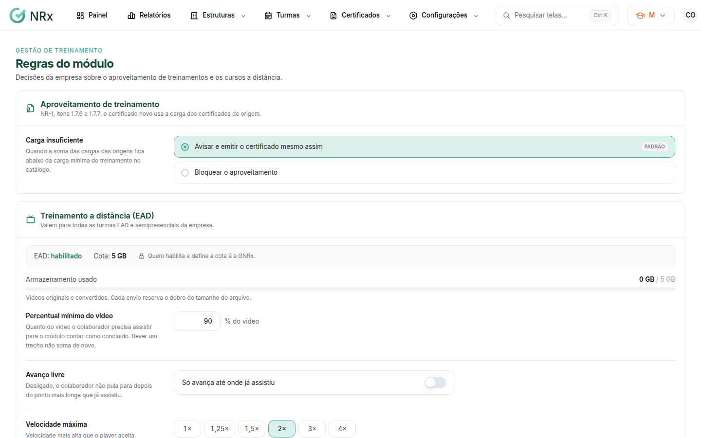

# Configurar as regras do módulo

**Para que serve:** decidir as regras de aproveitamento de treinamentos e dos cursos a distância da empresa.


**Quem pode fazer:** Supervisor, Gestor ou Administrador, com a permissão de configurar as regras do módulo de Treinamentos.


## Antes de começar

* As regras do EAD valem para todas as turmas EAD e semipresenciais da empresa.

## Passo a passo



### Abra as regras

Clique em **Configurações › Regras do módulo**.

<figure><figcaption>
Regras do módulo
</figcaption></figure>



### Aproveitamento

Em **Carga insuficiente**, escolha o que fazer quando a soma das cargas das origens fica abaixo da carga mínima do treinamento: **Avisar e emitir o certificado mesmo assim** ou **Bloquear o aproveitamento**.



### EAD

Ajuste:

* **Percentual mínimo do vídeo:** quanto o colaborador precisa assistir para o módulo contar.
* **Avanço livre:** **Pode avançar o vídeo** ou **Só avança até onde já assistiu**.
* **Velocidade máxima:** trechos acima dela não contam.
* **Tentativas da prova.**
* **Reconhecimento facial:** **Ao começar cada módulo** e/ou **Ao começar a prova**. O app pede uma foto, que é conferida com o cadastro facial.



### Salve

Clique em **Salvar regras**. Aparece "Regras salvas.".



## Dúvidas comuns

Ligo o reconhecimento facial. O que o colaborador precisa?

Ter o rosto cadastrado no reconhecimento facial. Sem isso, ele vê "Cadastre o reconhecimento facial antes de continuar.".

Para que serve o Template do WhatsApp do link?

É o nome do template aprovado na Meta, na conta de WhatsApp da empresa, para enviar o link do EAD. Em branco, o link só sai por e-mail ou copiado. Quem habilita e define a cota é a GNRx.

