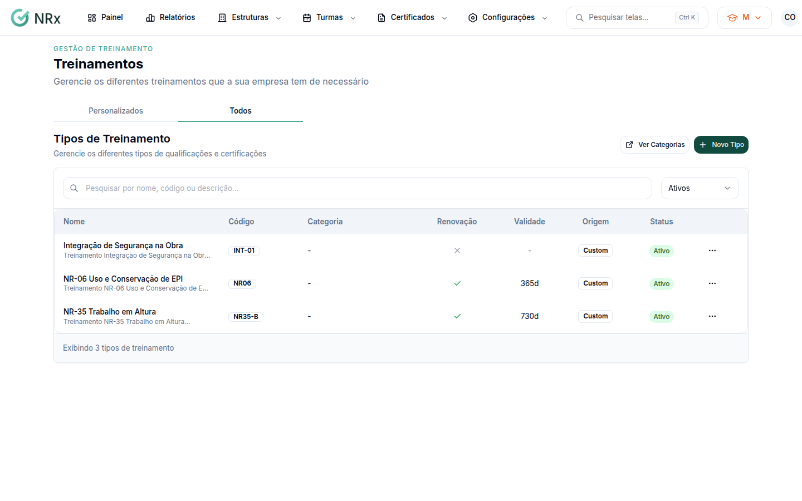
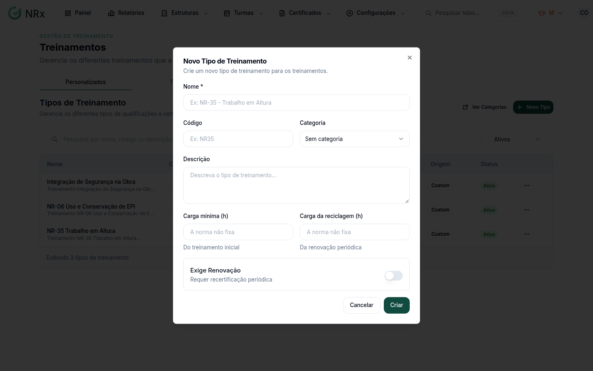

# Cadastrar um tipo de treinamento

**Para que serve:** cadastrar um treinamento no catálogo (ex.: NR-35), com carga, validade e categoria. As turmas e os cursos EAD saem dele.


**Quem pode fazer:** Gestor ou Administrador, com a permissão de cadastrar treinamentos.


## Antes de começar

* Veja se o treinamento já existe. Os de origem **Sistema** já vêm prontos.

## Passo a passo



### Abra o catálogo

Clique em **Configurações › Tipos de Treinamentos**. Use **Pesquisar por nome, código ou descrição...** e os filtros **Personalizados** / **Todos**.

<figure><figcaption>
Tipos de Treinamento
</figcaption></figure>



### Clique em Novo Tipo

Clique em **Novo Tipo**. Preencha o **Nome** (ex.: NR-35 - Trabalho em Altura), o **Código** (ex.: NR35), a **Categoria** e a **Descrição**.

<figure><figcaption>
Novo Tipo de Treinamento
</figcaption></figure>



### Informe cargas e validade

Preencha a **Carga mínima (h)** do treinamento inicial e a **Carga da reciclagem (h)**. Se precisa de recertificação, ligue **Exige Renovação** e informe a **Validade (dias)** (ex.: 730 = 2 anos).



### Salve

Salve. Aparece "Tipo de treinamento criado com sucesso!".



## Deu errado?

| Mensagem na tela | O que fazer |
| --- | --- |
| "Nome deve ter no mínimo 3 caracteres" | Escreva o nome completo. |
| "Validade em dias é obrigatória quando exige renovação" | Informe a validade em dias. |
| "A carga vai de 1 a 2.000 horas" | Ajuste a carga. |

## Dúvidas comuns

Como tiro um treinamento do catálogo?

Na lista, clique em **Inativar** e confirme em **Inativar Treinamento**. "O tipo não aparecerá mais na lista." Para trazer de volta, filtre **Inativos** e clique em **Reativar**.

E as categorias?

Clique em **Ver Categorias** para organizar os treinamentos por categoria.

Onde ficam o conteúdo, a prova e o EAD?

Abra o treinamento. As abas **Informações**, **Avaliações** e **EAD** guardam o [conteúdo programático](conteudo-programatico.md), as [avaliações](avaliacoes-do-treinamento.md) e o [curso a distância](../portal-do-aluno/montar-curso-ead.md).

