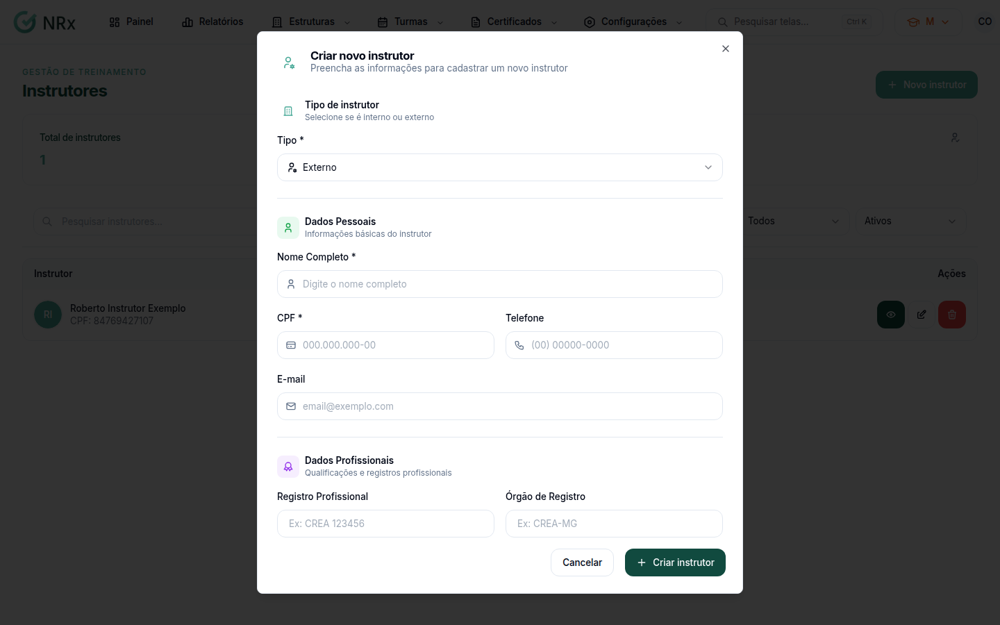

# Criar um instrutor

**Para que serve:** cadastrar quem vai ministrar os treinamentos.


**Quem pode fazer:** Gestor ou Administrador, com a permissão de cadastrar instrutores.


## Antes de começar

* Instrutor interno: ele precisa estar cadastrado como [colaborador](../colaboradores/criar-colaborador.md).
* Instrutor externo: tenha o CPF dele.

## Passo a passo



### Clique em Novo instrutor

Clique em **Estruturas › Instrutores** e depois em **Novo instrutor**. Abre **Criar novo instrutor**.

<figure><figcaption>
Criar novo instrutor
</figcaption></figure>



### Escolha o tipo

Em **Tipo de instrutor**, escolha:

* **Interno (colaborador):** clique em **Buscar colaborador**, digite o nome ou o CPF e escolha a pessoa.
* **Externo:** preencha o nome completo e o CPF.



### Complete os dados

Se quiser, preencha **Telefone**, **E-mail**, **Registro Profissional** (ex.: CREA 123456), **Órgão de Registro** (ex.: CREA-MG), **Formação Acadêmica** e **Observações**.



### Crie

Clique em **Criar instrutor**. Aparece "Instrutor criado com sucesso".



## Deu errado?

| Mensagem na tela | O que fazer |
| --- | --- |
| "Instrutor interno deve estar vinculado a um funcionário" | Clique em **Buscar colaborador** e escolha a pessoa. |
| "Instrutor externo deve ter CPF informado" | Preencha o CPF. |
| "Nome deve ter no mínimo 3 caracteres" | Escreva o nome completo. |
| "CPF inválido" | Confira o CPF. |

## Dúvidas comuns

Qual a diferença entre interno e externo?

O interno é um colaborador da empresa. O externo é alguém de fora, cadastrado só com os dados dele.

Onde vejo o que o instrutor já ministrou?

Na lista, clique em **Ver Detalhes**. A aba **Treinamentos** mostra os **Treinamentos Ministrados**.

