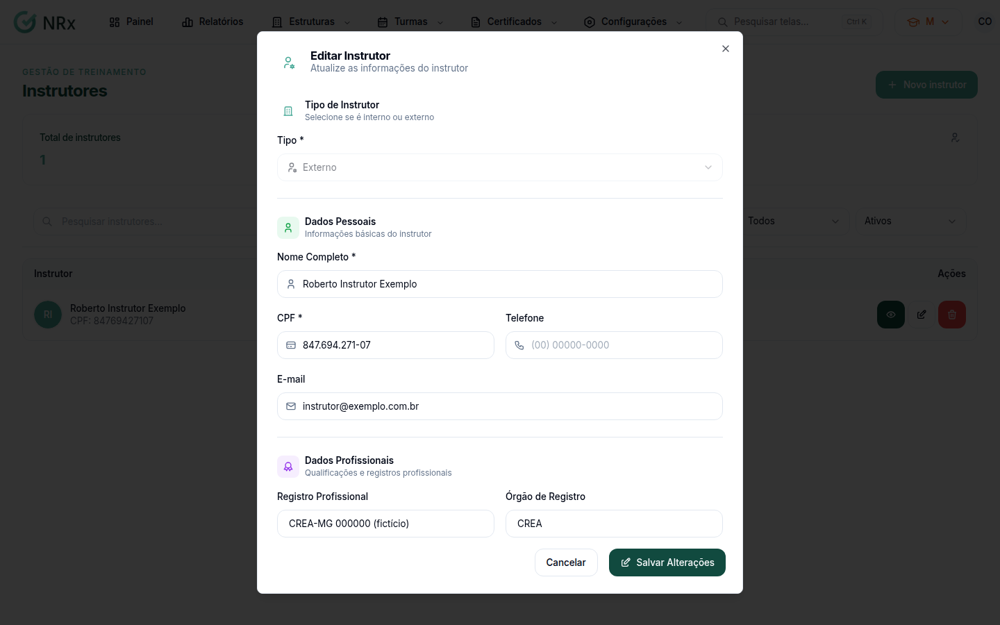
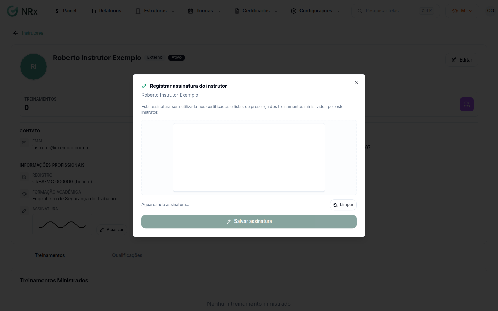

# Editar um instrutor

**Para que serve:** corrigir os dados de um instrutor e registrar a assinatura dele.


**Quem pode fazer:** Gestor ou Administrador, com a permissão de editar instrutores.


## Antes de começar

* Encontre o instrutor em **Estruturas › Instrutores**.

## Passo a passo



### Abra a edição

Na coluna **Ações**, clique em **Editar**. Abre **Editar Instrutor**: "Atualize as informações do instrutor".

<figure><figcaption>
Editar Instrutor
</figcaption></figure>



### Corrija e salve

Altere o que precisar e clique em **Salvar Alterações**. Aparece "Instrutor atualizado com sucesso".



### Registre a assinatura (se precisar)

Clique em **Ver Detalhes** e depois em **Registrar assinatura**. Na janela **Registrar assinatura do instrutor**, o instrutor desenha a assinatura. Clique em **Salvar assinatura**. Aparece "Assinatura do instrutor registrada com sucesso.".

<figure><figcaption>
Registrar assinatura do instrutor
</figcaption></figure>



## Deu errado?


**"Por favor, assine antes de confirmar."**: o campo de assinatura está vazio. Peça ao instrutor para assinar.


## Dúvidas comuns

Como apago a assinatura desenhada errada?

Clique em **Limpar** antes de salvar.

Onde ficam as qualificações?

Em **Ver Detalhes**, na aba **Qualificações** (**Qualificações e Habilitações**). As qualificações são os certificados do instrutor: para incluir uma, adicione um certificado por aqui, como em [Anexar um certificado](../../certificados/anexar-certificado.md). Cada uma mostra se está **Válido**, **Próximo do vencimento**, **Vencido** ou **Sem validade**.

