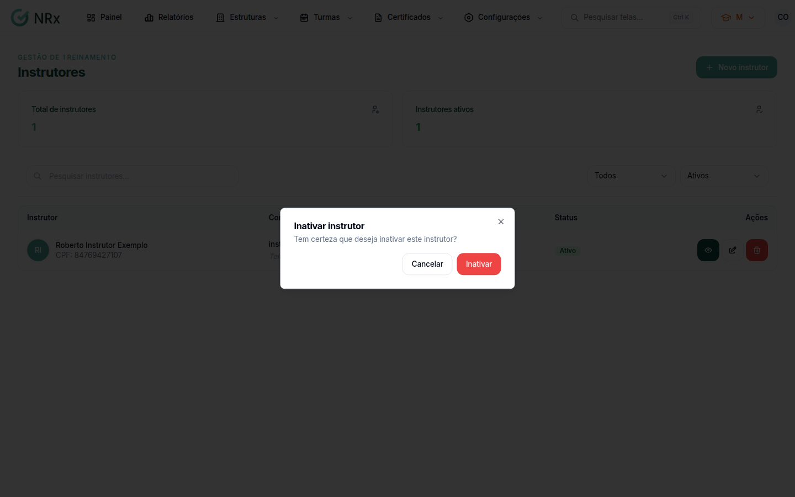

# Inativar ou reativar um instrutor

**Para que serve:** tirar da lista quem não ministra mais treinamentos, ou trazer de volta.


**Quem pode fazer:** Gestor ou Administrador, com a permissão de inativar instrutores.


## Antes de começar

* Encontre o instrutor em **Estruturas › Instrutores**.

## Passo a passo



### Inative

Na coluna **Ações**, clique em **Inativar**. Em **Inativar instrutor** ("Tem certeza que deseja inativar este instrutor?"), confirme. Aparece "Instrutor inativado com sucesso!".

<figure><figcaption>
Inativar instrutor
</figcaption></figure>



### Para reativar

Em **Situação**, escolha **Inativos**. Na coluna **Ações**, clique em **Reativar** e confirme em **Reativar instrutor**. Aparece "Instrutor reativado com sucesso!".



## Dúvidas comuns

Como acho um instrutor?

Use **Pesquisar instrutores...** e o filtro **Tipo**.

Como acho os instrutores inativos?

Em **Situação**, escolha **Inativos**.

