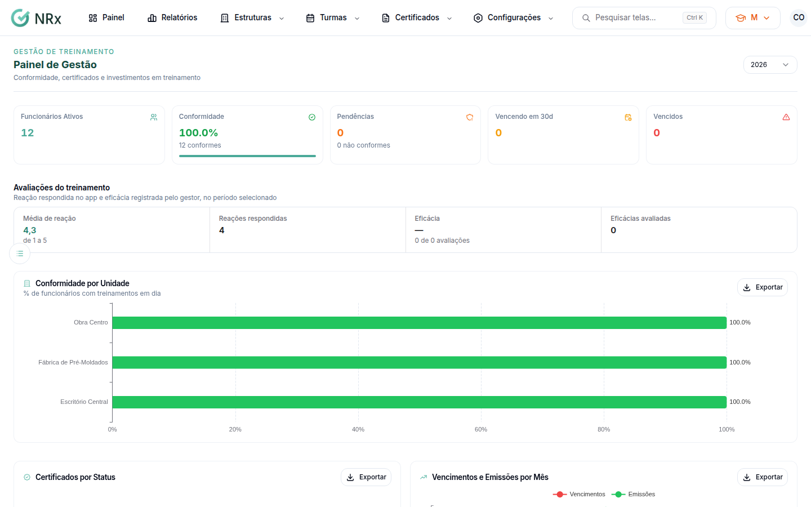

# Ver o painel de treinamentos

**Para que serve:** acompanhar, numa tela só, a conformidade, os vencimentos, as avaliações e os custos dos treinamentos.


**Quem pode fazer:** Supervisor, Gestor ou Administrador, com a permissão de ver o dashboard de validades.


## Antes de começar

* Nada a preparar.

## Passo a passo



### Abra o painel

Clique em **Painel**, no topo da barra (em telas menores, só o ícone aparece). Abre o **Painel de Gestão**, com **Funcionários Ativos**, **Vencendo em 30d**, **Média de reação**, **Reações respondidas** e **Eficácias avaliadas**.

<figure><figcaption>
Painel de Gestão
</figcaption></figure>



### Veja os gráficos

* **Conformidade por Unidade:** % de funcionários com treinamentos em dia.
* **Certificados por Status** e **Vencimentos e Emissões por Mês**.
* **Investimento Financeiro:** **Custo Total**, **Treinamentos Concluídos**, **Horas Treinadas**, **Custo Médio / Participante** e **Custo por Unidade**.



### Veja as não conformidades

Em **Não Conformidades**, use **Buscar funcionário ou treinamento...**.



## Dúvidas comuns

Posso exportar um gráfico?

Pode. No gráfico, use **Exportar como PNG**, **Exportar como SVG** ou **Exportar como Excel**.

Apareceu "Nenhuma pendência encontrada".

Ninguém está com treinamento pendente.

