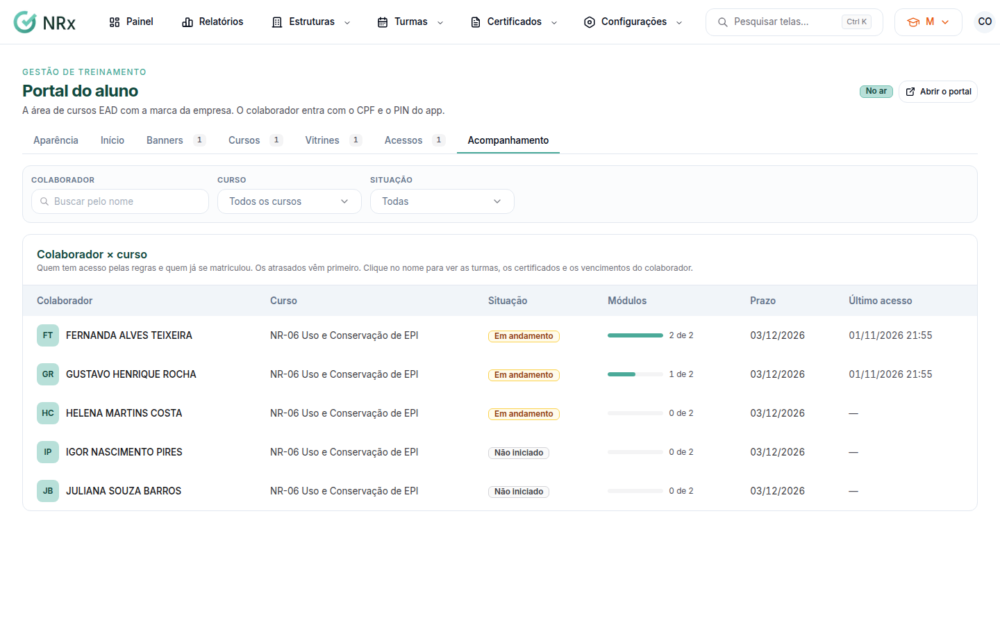

# Acompanhar os alunos

**Para que serve:** ver quem tem acesso a cada curso, quem já fez e quem está atrasado.


**Quem pode fazer:** Supervisor, Gestor ou Administrador, com a permissão de ver a análise do EAD.


## Antes de começar

* [Libere os acessos](liberar-acessos.md).

## Passo a passo



### Abra o acompanhamento

Na aba **Acompanhamento**, veja **Colaborador × curso**: **Situação**, **Módulos**, **Prazo** e **Último acesso**. Os atrasados vêm primeiro.

<figure><figcaption>
Acompanhamento
</figcaption></figure>



### Filtre

Use **Buscar pelo nome** e **Todos os cursos**. Clique no nome para ver as turmas, os certificados e os vencimentos da pessoa.



## Dúvidas comuns

Apareceu "Ninguém com acesso ainda".

Dê acesso aos cursos na aba **Acessos**.

O que é "Por certificado válido"?

A pessoa já tem certificado válido do treinamento.

