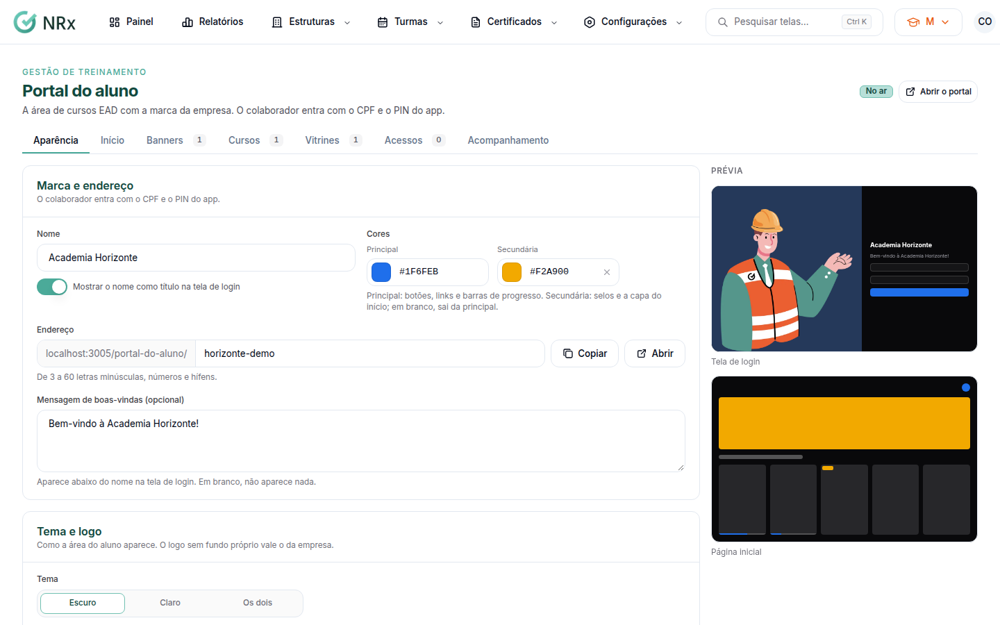

# Criar o portal do aluno

**Para que serve:** colocar no ar a área de cursos da empresa, com nome, endereço, cores e logo.


**Quem pode fazer:** Supervisor, Gestor ou Administrador, com a permissão de gerenciar o conteúdo do EAD.


## Antes de começar

* Tenha o logo da empresa (para fundo claro e escuro, se tiver).

## Passo a passo



### Dê nome e endereço

Clique em **Turmas › Portal do aluno** e abra a aba **Aparência**. Em **Marca e endereço**, dê um nome (ex.: Portal do aluno ACME) e um endereço (de 3 a 60 letras minúsculas, números e hífens). Clique em **Criar portal**. Aparece "Portal criado.".

<figure><figcaption>
Aba Aparência
</figcaption></figure>



### Ajuste a aparência

Em **Tema e logo**, escolha as cores **Principal** e **Secundária** e os logos para fundo claro e escuro. Se quiser, escreva a **Mensagem de boas-vindas** e a imagem da tela de login. Veja a **Prévia** e clique em **Salvar aparência**. Aparece "Aparência salva.".



### Divulgue

Ligue **Portal no ar**. Use **Copiar** para copiar o endereço ou **Imprimir cartaz A4** para colar no mural, no refeitório ou na portaria.



## Deu errado?


**"Este endereço já é de outra empresa. Escolha outro."**: troque o endereço.


## Dúvidas comuns

Como o colaborador entra?

Com o CPF e o mesmo PIN de 6 dígitos do app GNRx Colaborador.

E se eu não enviar logo?

Sem logo próprio, vale o logo da empresa.

