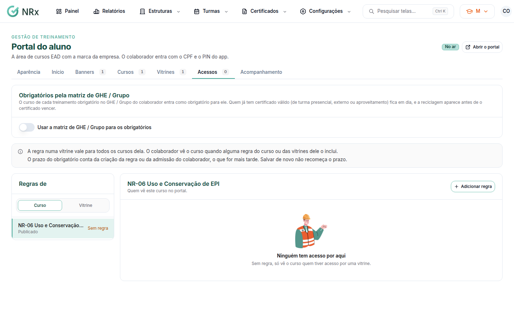

# Liberar os acessos aos cursos

**Para que serve:** dizer quem vê cada curso ou vitrine no portal, e o que é obrigatório.


**Quem pode fazer:** Supervisor, Gestor ou Administrador, com a permissão de gerenciar o conteúdo do EAD.


## Antes de começar

* [Crie o portal](criar-portal.md) e publique os cursos.

## Passo a passo



### Escolha o curso ou a vitrine

Na aba **Acessos**, escolha um curso ou uma vitrine à esquerda.

<figure><figcaption>
Aba Acessos
</figcaption></figure>



### Adicione as regras

Clique em **Adicionar regra** e escolha quem vê: todos os colaboradores ativos, uma unidade, um setor, um cargo, um GHE / Grupo ou um colaborador. Marque **Obrigatório** e o **Prazo em dias** (de 1 a 3650), se for o caso.



### Salve

Clique em **Salvar acessos**. Aparece "Acessos salvos.".




**Pela matriz de GHE:** ligue **Usar a matriz de GHE / Grupo para os obrigatórios**. O curso de cada treinamento obrigatório no GHE do colaborador entra como obrigatório para ele.


## Deu errado?

| Mensagem na tela | O que fazer |
| --- | --- |
| "Há regra repetida." | Tire a regra duplicada. |
| "O prazo vai de 1 a 3650 dias." | Ajuste o prazo. |

## Dúvidas comuns

Curso sem regra aparece para alguém?

Só para quem tem acesso por uma vitrine. Vitrine sem regra não libera curso para ninguém.

Obrigatório sem prazo atrasa?

Não. Sem prazo, o curso aparece em Obrigatórios, sem atrasar.

