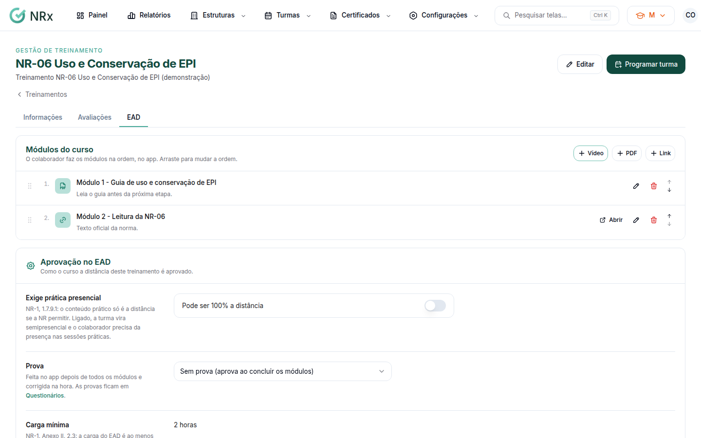
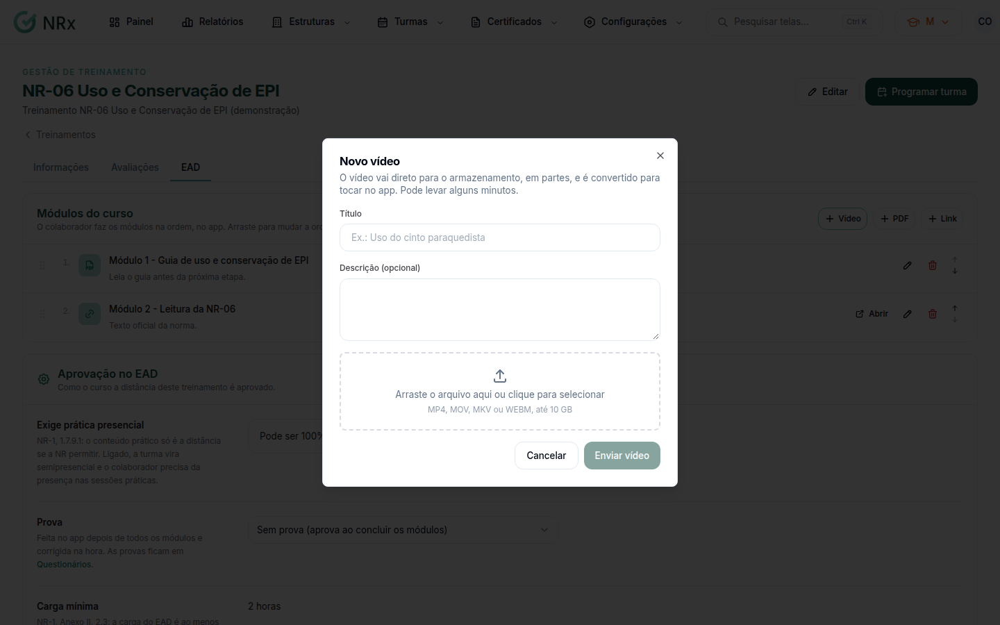

# Montar o conteúdo de um curso EAD

**Para que serve:** enviar os módulos (vídeos, PDFs e links) de um treinamento do catálogo e dizer como ele é aprovado a distância.


**Quem pode fazer:** Supervisor, Gestor ou Administrador, com a permissão de gerenciar o conteúdo do EAD.


## Antes de começar

* O treinamento precisa estar no catálogo, em **Configurações › Tipos de Treinamentos**.
* Tenha os vídeos em MP4, MOV, MKV ou WEBM (até 10 GB) e os PDFs (até 20 MB).

## Passo a passo



### Abra a aba EAD do treinamento

Clique em **Configurações › Tipos de Treinamentos**, abra o treinamento e vá à aba **EAD**.

<figure><figcaption>
Aba EAD do treinamento
</figcaption></figure>



### Envie os módulos

Em **Módulos do curso**, comece pelo vídeo: clique em **Novo vídeo**, dê um título (ex.: Uso do cinto paraquedista) e clique em **Enviar vídeo**. Aparece "Vídeo enviado. A conversão começa agora.". Enquanto ele converte, adicione **Novo PDF** e **Novo link** (só endereços https).

<figure><figcaption>
Novo vídeo
</figcaption></figure>



### Ajuste a ordem

Arraste os módulos (ou use **Subir módulo** / **Descer módulo**). O colaborador faz os módulos na ordem, no app. Se quiser, em **Editar módulo**, ligue **Abrir só depois de alguns dias da inscrição** (de 1 a 365 dias).



### Defina a aprovação

Em **Aprovação no EAD**, escolha um questionário (a prova) ou **Sem prova (aprova ao concluir os módulos)**. Se a NR exige prática, ligue **Exige prática presencial**. Clique em **Salvar**. Aparece "Configuração do EAD salva.".



Depois, [publique o curso no portal](publicar-curso.md).

## Deu errado?

| Mensagem na tela | O que fazer |
| --- | --- |
| "Formato de vídeo não aceito." | Converta para MP4, MOV, MKV ou WEBM. |
| "O envio parou. Retome: só as partes que faltam sobem de novo." | Clique em **Retomar envio**. |
| "A infraestrutura de vídeo não está configurada. Tente de novo mais tarde." | Aguarde e tente de novo. Se continuar, [abra um chamado](../suporte/abrir-chamado.md). |

## Dúvidas comuns

Quando o PDF e o link contam como feitos?

Quando o colaborador abre.

O que é "Exige prática presencial"?

Pela NR-1, o conteúdo prático só é a distância se a NR permitir. Ligado, a turma vira semipresencial e o colaborador precisa da presença nas sessões práticas.

Treinamento padrão da GNRx?

Nele, a prova e a parte prática são definidas pela GNRx.

