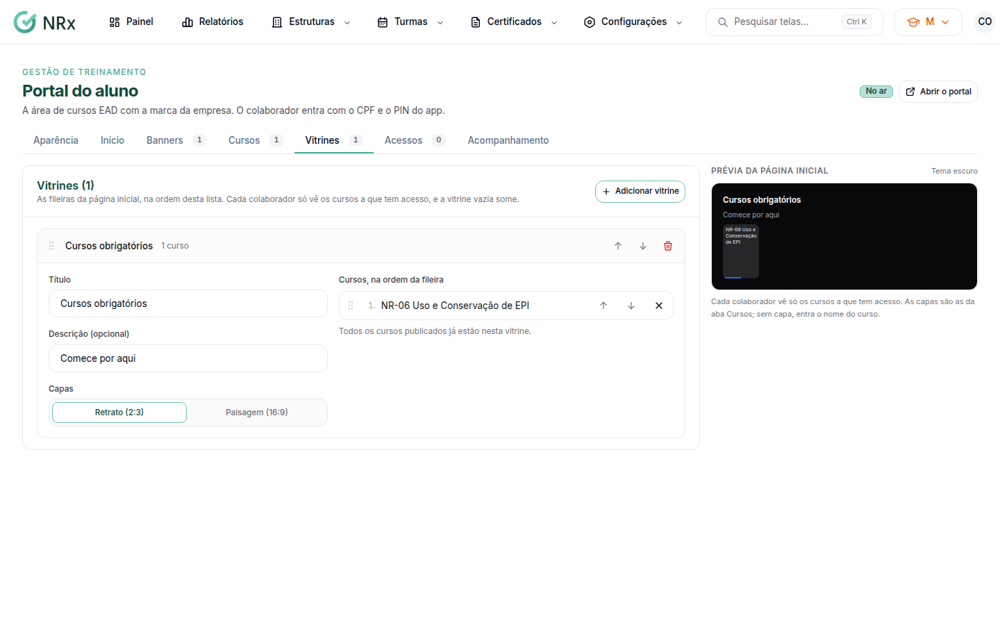

# Montar as vitrines

**Para que serve:** organizar os cursos em fileiras na página inicial do portal (ex.: "Integração").


**Quem pode fazer:** Supervisor, Gestor ou Administrador, com a permissão de gerenciar o conteúdo do EAD.


## Antes de começar

* [Publique os cursos](publicar-curso.md).

## Passo a passo



### Crie a vitrine

Na aba **Vitrines**, clique em **Adicionar vitrine**. Dê um nome (ex.: Integração) e, se quiser, uma descrição. Escolha o formato da capa: **Retrato (2:3)** ou **Paisagem (16:9)**.

<figure><figcaption>
Aba Vitrines
</figcaption></figure>



### Adicione os cursos

Em **Adicionar curso publicado…**, escolha os cursos. Arraste para ordenar a fileira e as vitrines.



### Salve

Clique em **Salvar vitrines**. Aparece "Vitrines salvas.".




Remover uma vitrine tira junto as regras de acesso dela.


## Dúvidas comuns

Por que a vitrine não aparece para o colaborador?

Cada colaborador só vê os cursos a que tem acesso. A vitrine vazia some.

Posso dar acesso pela vitrine?

Pode. Na aba **Acessos**, escolha a vitrine. Veja [Liberar os acessos](liberar-acessos.md).

