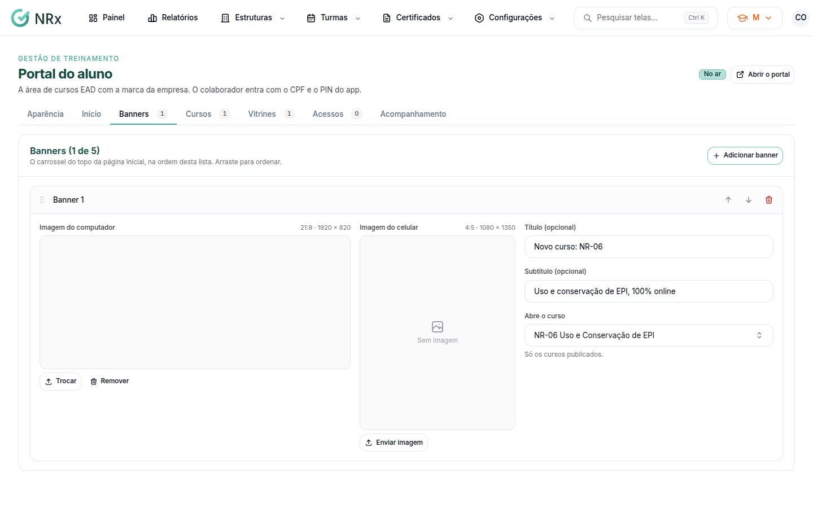
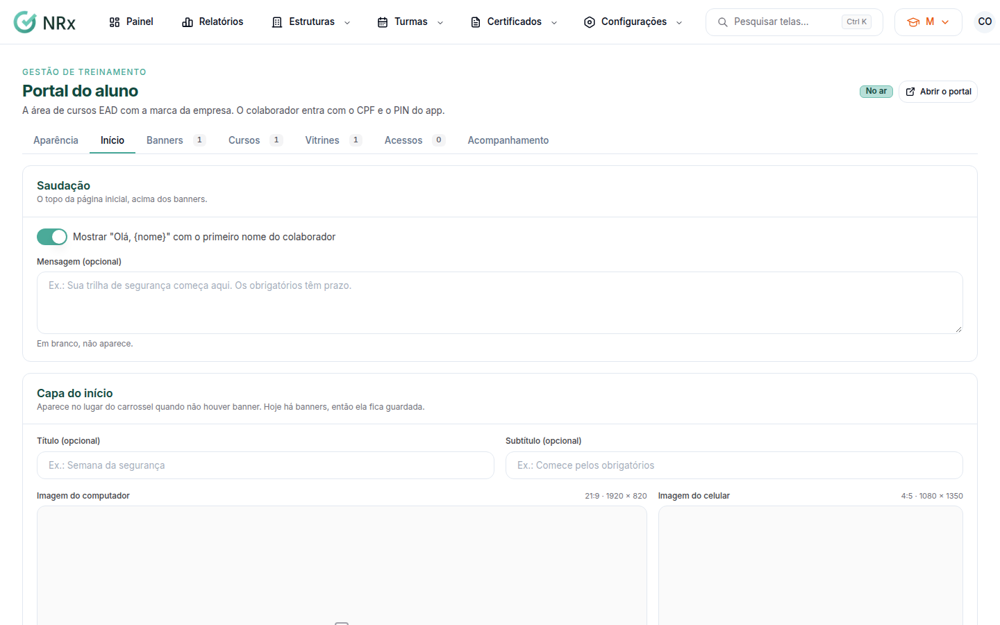

# Personalizar a página inicial do portal

**Para que serve:** ajustar o topo, os banners, a ordem das fileiras e a tela de quem ainda não tem curso.


**Quem pode fazer:** Supervisor, Gestor ou Administrador, com a permissão de gerenciar o conteúdo do EAD.


## Antes de começar

* [Crie o portal](criar-portal.md).

## Passo a passo



### Adicione banners (opcional)

Na aba **Banners**, clique em **Adicionar banner**. Envie a **Imagem do computador** e a **Imagem do celular**. Se quiser, escreva título e subtítulo e escolha o curso que o banner abre. Arraste para ordenar e clique em **Salvar banners**.

<figure><figcaption>
Aba Banners
</figcaption></figure>



### Ajuste o início

Na aba **Início**, escreva a mensagem do topo. Sem banners, configure a **Capa do início**. Arraste as fileiras para ordenar. Em **Tela sem cursos**, ajuste o texto e, se quiser, um botão (ex.: Falar com o RH).

<figure><figcaption>
Aba Início
</figcaption></figure>



### Salve

Clique em **Salvar página inicial**. Aparece "Página inicial salva.".



## Deu errado?

| Mensagem na tela | O que fazer |
| --- | --- |
| "O botão da tela sem cursos precisa do texto e do link." | Preencha os dois ou deixe os dois em branco. |
| "O link do botão começa com https:// (o do WhatsApp também: https://wa.me/55…)." | Corrija o link. |
| "Deixe ao menos uma fileira visível." | Mostre pelo menos uma fileira. |

## Dúvidas comuns

Sem banner, o que aparece no topo?

A página começa pelas vitrines, ou pela **Capa do início**, se você configurar.

Como abro o WhatsApp pelo botão?

Use https://wa.me/55 e o número com DDD.

