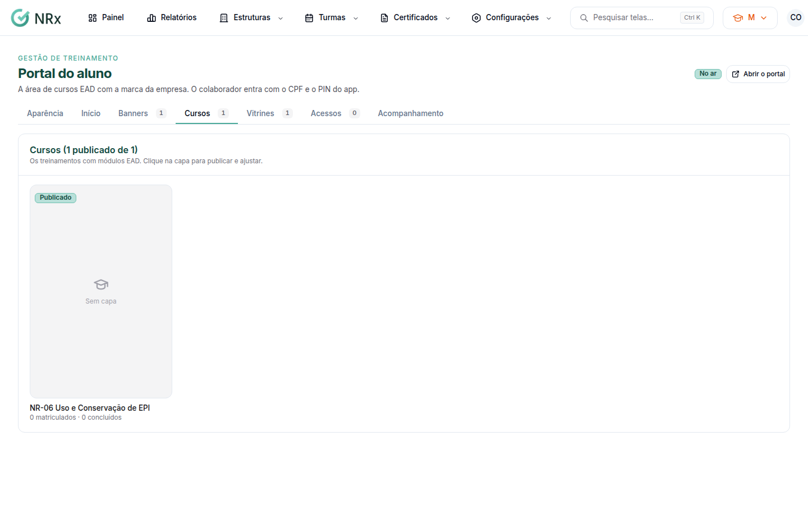
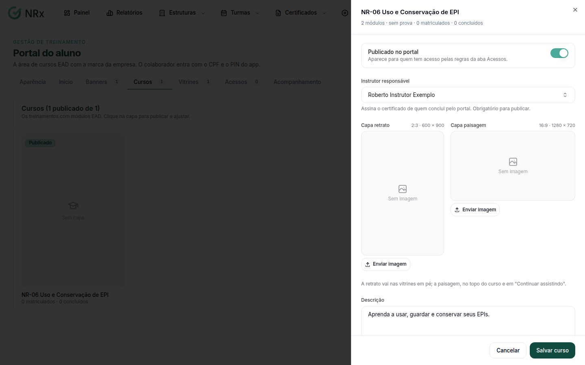

# Publicar um curso no portal

**Para que serve:** colocar um curso EAD no portal, com capa, descrição, carga horária e o instrutor que assina o certificado.


**Quem pode fazer:** Supervisor, Gestor ou Administrador, com a permissão de gerenciar o conteúdo do EAD.


## Antes de começar

* [Monte o conteúdo do curso](montar-curso-ead.md).
* Cadastre a [assinatura do instrutor](../estruturas/instrutores/editar-instrutor.md). Ele assina o certificado.

## Passo a passo



### Abra o curso

Clique em **Turmas › Portal do aluno**, aba **Cursos**. Aparecem os treinamentos com módulos EAD. Clique na capa do curso.

<figure><figcaption>
Aba Cursos
</figcaption></figure>



### Preencha e publique

Escolha o **Instrutor responsável** (obrigatório para publicar). Confira a **Carga horária**, escreva a descrição e envie a **Capa retrato** e a **Capa paisagem**. Ligue **Publicado no portal**. Clique em **Salvar curso**. Aparece "Curso salvo.".

<figure><figcaption>
Dados do curso
</figcaption></figure>



Depois, [libere os acessos](liberar-acessos.md).

## Deu errado?

| Mensagem na tela | O que fazer |
| --- | --- |
| "Ainda não tem módulo disponível. Envie os vídeos na aba EAD do treinamento." | [Monte o conteúdo](montar-curso-ead.md). |
| "Falta o conteúdo programático do treinamento no catálogo: ele vai no certificado." | Clique em **Cadastrar o conteúdo programático**. |
| "Tem parte prática: não conclui só a distância. Programe uma turma semipresencial." | [Programe uma turma](../turmas/programar-treinamento.md) semipresencial. |
| "Este instrutor foi inativado. Escolha outro." | Escolha outro instrutor ativo. |
| "Instrutor sem assinatura" | Cadastre a [assinatura do instrutor](../estruturas/instrutores/editar-instrutor.md). |

## Dúvidas comuns

Quem vê o curso publicado?

Quem tem acesso pelas regras da aba **Acessos**.

A carga horária já vem preenchida?

Vem sugerida: a gravada, a mínima do catálogo ou a soma dos vídeos.

