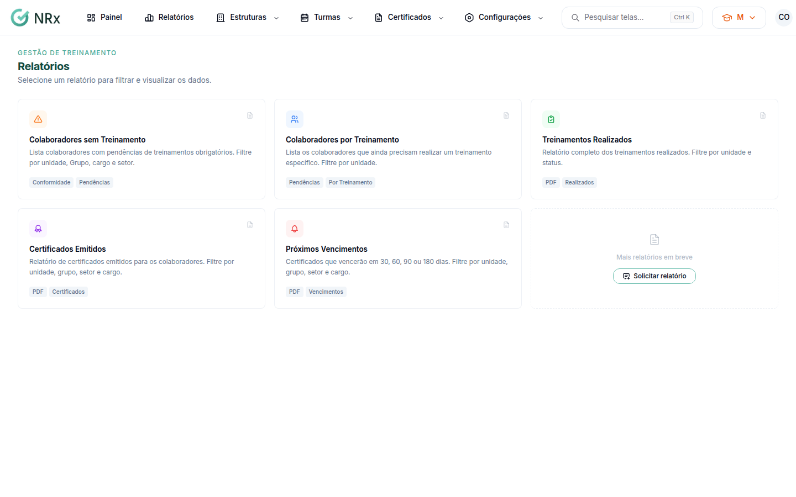

# Gerar um relatório

**Para que serve:** listar quem está sem treinamento, as turmas realizadas, os certificados emitidos e os próximos vencimentos, e gerar o PDF.


**Quem pode fazer:** Supervisor, Gestor ou Administrador, com a permissão de gerar relatórios de participação.


## Antes de começar

* Nada a preparar.

## Passo a passo



### Escolha o relatório

Clique em **Relatórios** e escolha:

* **Colaboradores sem Treinamento:** pendências de treinamentos obrigatórios, por unidade, grupo, cargo e setor.
* **Colaboradores por Treinamento:** quem ainda precisa fazer um treinamento específico.
* **Treinamentos Realizados:** por unidade e status.
* **Certificados Emitidos:** por unidade, grupo, setor e cargo.
* **Próximos Vencimentos:** certificados que vencem em 30, 60, 90 ou 180 dias.

<figure><figcaption>
Relatórios
</figcaption></figure>



### Filtre

Escolha os filtros (unidade, GHE, cargo, setor, status). **Limpar filtros** volta ao início.



### Gere o PDF

Clique em **Gerar PDF** (ou **Exportar PDF**). Aparece "PDF gerado com sucesso!".



## Deu errado?


**"Erro ao gerar PDF"**: tente novamente.


## Dúvidas comuns

Preciso de um relatório que não existe.

Clique em **Solicitar relatório**, descreva o que precisa e clique em **Enviar solicitação**.

Apareceu "Todos os colaboradores estão em conformidade."

Ninguém está com pendência nos filtros escolhidos.

