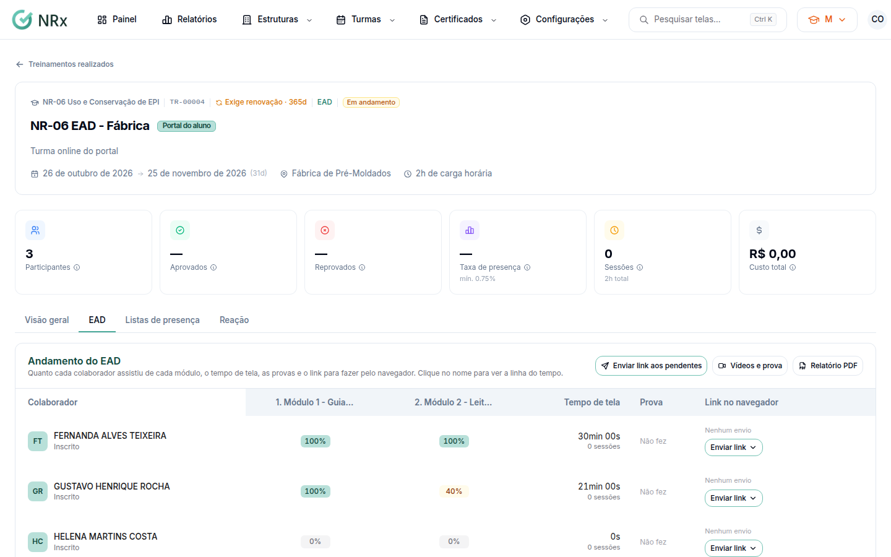
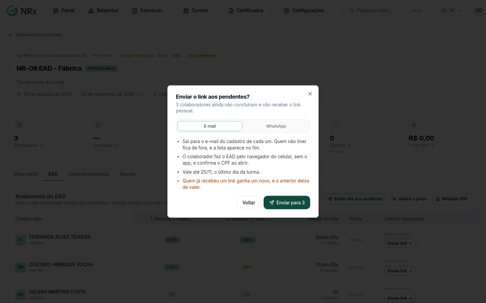

# Acompanhar uma turma EAD

**Para que serve:** ver quanto cada colaborador assistiu de cada módulo, o tempo de tela e as provas, e mandar o link a quem ainda não terminou.


**Quem pode fazer:** Supervisor, Gestor ou Administrador, com a permissão de ver a análise do EAD.


## Antes de começar

* A turma precisa ser EAD ou semipresencial e ter participantes.

## Passo a passo



### Abra a aba EAD

Abra a turma e vá à aba **EAD**. Em **Andamento do EAD**, cada linha mostra o colaborador, os módulos, o **Tempo de tela**, a **Prova** e o **Link no navegador**.

<figure><figcaption>
Andamento do EAD
</figcaption></figure>



### Veja a linha do tempo

Clique no nome do colaborador. A **Linha do tempo** mostra **Quando**, **Módulo**, **O quê**, **Trecho** e se **Contou**.



### Mande o link a quem falta

Clique em **Enviar link aos pendentes** e confirme. O link vai para todos que não concluíram nem foram reprovados. Para uma pessoa só, use a coluna **Link no navegador**: **Por e-mail**, **Por WhatsApp** ou **Copiar link**.

<figure><figcaption>
Enviar o link
</figcaption></figure>




Um envio novo substitui o link anterior, que deixa de valer.


## Deu errado?

| Mensagem na tela | O que fazer |
| --- | --- |
| "O link foi gerado, mas o envio falhou. Confira o contato e tente de novo." | Confira o e-mail ou o telefone no cadastro do colaborador. |
| "Nada para acompanhar" | A turma não tem participante ou não é a distância. |

## Dúvidas comuns

Como guardo o andamento?

Clique em **Relatório PDF**.

O contato veio errado no envio.

O contato vem do cadastro. Se mudar na janela, vale só para aquele envio.

