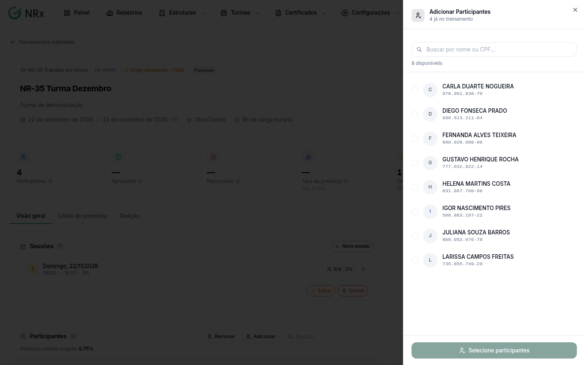

# Ajustar a turma

**Para que serve:** mudar os dados da turma, os participantes, as sessões e os arquivos.


**Quem pode fazer:** Supervisor, Gestor ou Administrador, com a permissão de editar turmas.


## Antes de começar

* [Encontre a turma](encontrar-turma.md).

## Passo a passo



### Edite os dados

Clique em **Editar**. Em **Editar Treinamento**, ajuste nome, descrição, datas, **Presença mínima (%)** e **Informações de Custo**. Clique em **Salvar alterações**. Aparece "Treinamento atualizado com sucesso.".



### Ajuste os participantes

Em **Participantes**, clique em **Gerenciar**. Em **Adicionar Participantes**, busque por nome ou CPF e marque as pessoas. Para tirar alguém, use **Remover** na lista.

<figure><figcaption>
Adicionar Participantes
</figcaption></figure>



### Adicione uma sessão

Em **Sessões**, clique em **Nova sessão**. Informe **Data**, **Início** e **Fim**. A **Carga horária (h)** é calculada automaticamente. Clique em **Adicionar sessão**.



### Anexe arquivos

Clique em **Adicionar arquivo**. Escolha o tipo (**Documento**, **Imagem**, **Vídeo** ou **Certificado**), dê um nome (ex.: "Lista de presença - Turma Janeiro"), escolha a **Sessão** se quiser e envie.



## Deu errado?

| Mensagem na tela | O que fazer |
| --- | --- |
| "Treinamento salvo com avisos" | Algumas sessões ficaram fora do novo período. Ajuste as sessões. |
| "Data de fim deve ser maior ou igual à data de início." | Confira as datas. |
| "Hora de fim deve ser maior que hora de início" | Confira os horários da sessão. |
| "Conflito com sessão do dia anterior." | Mude o horário da sessão. |

## Dúvidas comuns

Apareceu "Todos os colaboradores já estão no treinamento".

Não há mais ninguém para adicionar.

Posso mudar o instrutor?

Pode. Em **Instrutores**, clique em **Gerenciar** (ou **Adicionar Instrutor**).

