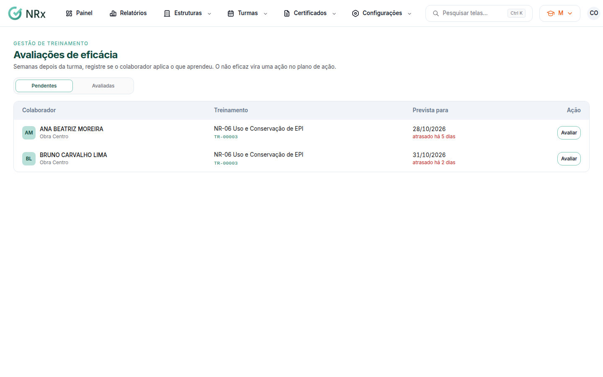
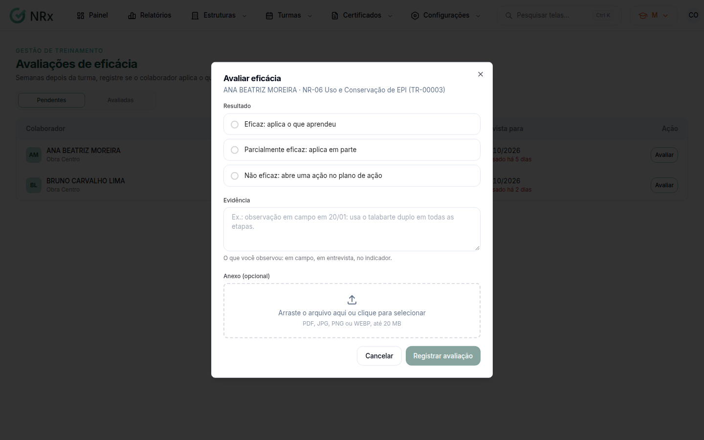

# Avaliar a eficácia

**Para que serve:** registrar, semanas depois da turma, se o colaborador aplica o que aprendeu. O não eficaz vira uma ação no plano de ação.


**Quem pode fazer:** Supervisor, Gestor ou Administrador, com a permissão de registrar a avaliação de eficácia.


## Antes de começar

* A avaliação aparece na data prevista, depois da conclusão da turma.

## Passo a passo



### Abra as avaliações

Clique em **Turmas › Avaliações de eficácia**. A lista mostra **Colaborador**, **Treinamento** e **Prevista para**.

<figure><figcaption>
Avaliações de eficácia
</figcaption></figure>



### Avalie

Na linha do colaborador, clique em **Avaliar**. Em **Avaliar eficácia**, escolha o resultado:

* **Eficaz:** aplica o que aprendeu;
* **Parcialmente eficaz:** aplica em parte;
* **Não eficaz:** abre uma ação no plano de ação.

Escreva o que você observou (em campo, em entrevista, no indicador). Se quiser, anexe um arquivo.

<figure><figcaption>
Avaliar eficácia
</figcaption></figure>



### Registre

No **Não eficaz**, preencha a ação: **O quê** (ex.: reciclagem prática de NR-35), **Até quando** e o responsável. Clique em **Registrar avaliação**. Aparece **Avaliação registrada**.



## Dúvidas comuns

Apareceu "Nenhuma avaliação pendente".

As novas aparecem na data prevista, depois da conclusão das turmas.

Errei a avaliação. Como corrijo?

Na linha do colaborador, o botão vira **Refazer**. Clique nele e registre de novo.

Onde vejo a ação aberta?

Clique em **Ver no plano de ação**.

