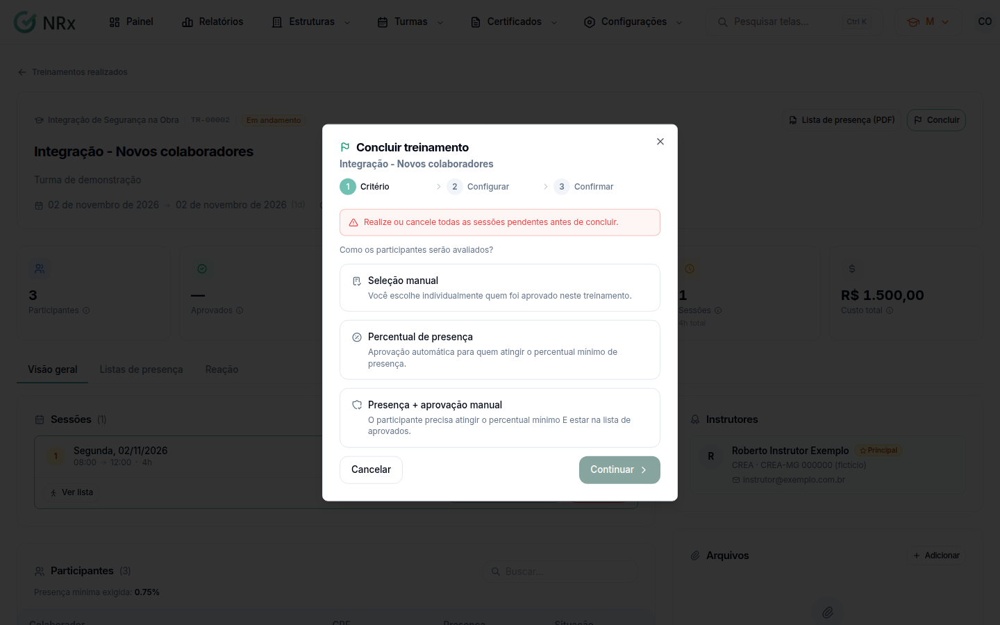

# Concluir a turma

**Para que serve:** encerrar a turma e definir quem foi aprovado.


**Quem pode fazer:** Gestor ou Administrador, com a permissão de finalizar turmas.


## Antes de começar

* [Registre a presença](registrar-presenca.md) de todas as sessões.

## Passo a passo



### Clique em Concluir

Abra a turma e clique em **Concluir**. Abre **Concluir treinamento**: "Como os participantes serão avaliados?".

<figure><figcaption>
Concluir treinamento
</figcaption></figure>



### Escolha o critério

* **Seleção manual:** você escolhe quem foi aprovado. Use quando não há critério de presença.
* **Percentual de presença:** aprova automaticamente quem atingir o **Percentual mínimo de presença**.
* **Presença + aprovação manual:** precisa atingir o percentual **e** estar na lista de aprovados.



### Selecione e continue

Quando for o caso, marque os aprovados (**Selecionar elegíveis** marca quem atingiu a presença). Clique em **Continuar**. Aparece **Treinamento concluído!**, com os aprovados e os **Reprovados**.



## Dúvidas comuns

Onde vejo os aprovados depois?

Na **Visão geral** da turma, em **Aprovados** e **Reprovados**, e na lista de **Participantes**.

E o certificado?

Os aprovados aparecem com **Baixar certificado** na lista de participantes.

