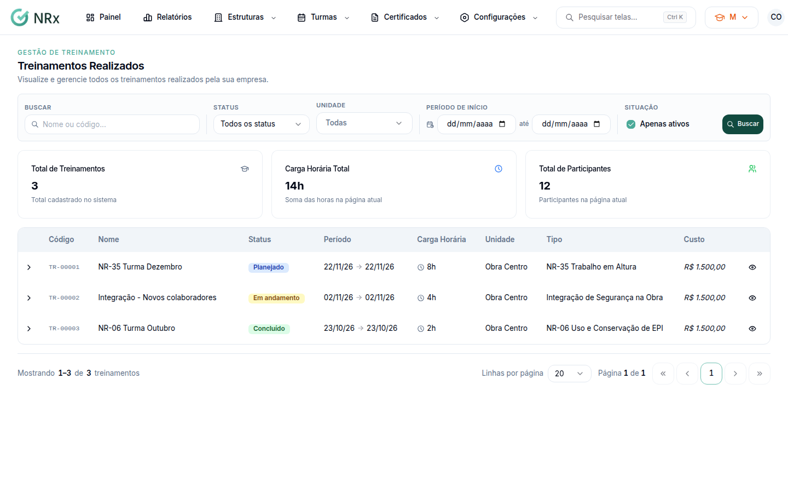

# Encontrar uma turma

**Para que serve:** achar uma turma e abrir a página dela.


**Quem pode fazer:** Supervisor, Gestor ou Administrador, com a permissão de ver treinamentos.


## Antes de começar

* Nada a preparar.

## Passo a passo



### Abra a lista

Clique em **Turmas › Treinamentos**. Abre **Treinamentos Realizados**.

<figure><figcaption>
Treinamentos Realizados
</figcaption></figure>



### Filtre

Digite o nome ou o código e clique em **Buscar**. Em **Filtros**, escolha o **Status** (**Planejado**, **Em andamento**, **Concluído**), a **Unidade** e o **Período de início**. **Limpar tudo** tira os filtros.



### Abra a turma

Clique na turma. A página tem as abas **Visão geral**, **EAD**, **Listas de presença** e **Reação**.



## Dúvidas comuns

Apareceu "Nenhum treinamento encontrado".

Confira o termo e os filtros. Clique em **Limpar tudo**.

Turma "Geral" na coluna Unidade?

A turma é para a empresa toda, sem unidade.

