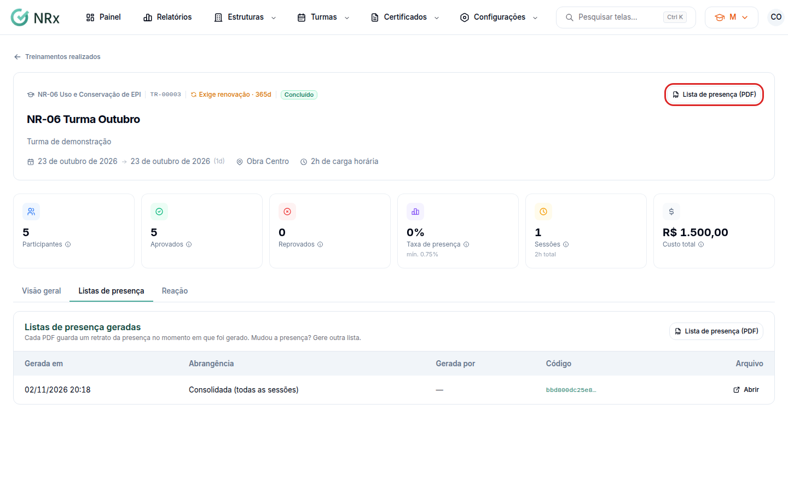

# Gerar a lista de presença

**Para que serve:** gerar o PDF da lista de presença, consolidada ou de uma sessão. O QR Code do PDF abre a página pública de validação.


**Quem pode fazer:** quem tem a permissão de ver turmas.


## Antes de começar

* [Registre a presença](registrar-presenca.md).

## Passo a passo



### Abra as listas

Abra a turma e vá à aba **Listas de presença**.

<figure><figcaption>
Listas de presença
</figcaption></figure>



### Gere o PDF

Clique em **Lista de presença (PDF)** para a lista **Consolidada (todas as sessões)**. Aparece "Lista gerada.". Para uma sessão só, use **Lista (PDF)** na sessão, na aba **Visão geral**.



### Abra

Em **Listas de presença geradas**, clique em **Abrir**.




Cada PDF guarda um retrato da presença no momento em que foi gerado. Mudou a presença? Gere outra lista.


## Dúvidas comuns

Para que serve o QR Code do PDF?

Abre a página pública de validação da lista.

Apareceu "Nenhuma lista gerada".

Gere a primeira lista no botão acima.

