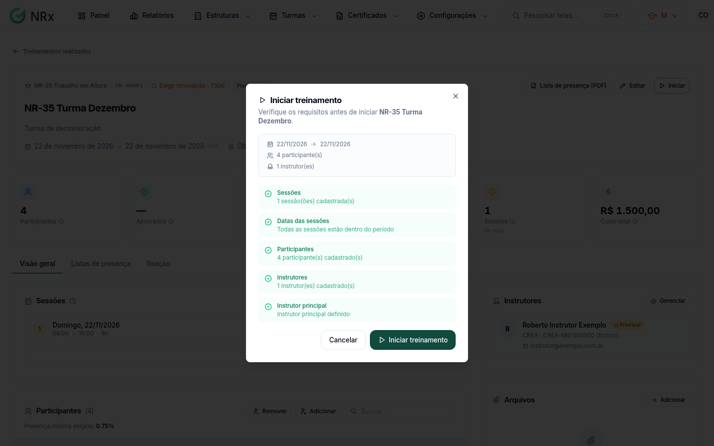

# Iniciar a turma

**Para que serve:** passar a turma de **Planejado** para **Em andamento**.


**Quem pode fazer:** quem pode editar turmas.


## Antes de começar

* A turma precisa ter participantes. No presencial, também sessões e um instrutor principal.

## Passo a passo



### Clique em Iniciar

Abra a turma e clique em **Iniciar**. Abre **Iniciar treinamento**, com a conferência: sessões, datas das sessões, participantes, instrutores e instrutor principal.

<figure><figcaption>
Iniciar treinamento
</figcaption></figure>



### Confirme

Se tudo estiver certo, clique em **Iniciar treinamento**. Aparece "Treinamento <código> iniciado com sucesso.".



## Deu errado?

O botão **Iniciar treinamento** fica desabilitado até tudo estar certo. Aparece "Resolva os problemas acima antes de iniciar o treinamento.".

| Mensagem na tela | O que fazer |
| --- | --- |
| "Nenhuma sessão cadastrada" | Adicione uma sessão. No EAD, elas são opcionais ("Sem sessões: no EAD elas são opcionais"). |
| Sessão fora do período, em **Datas das sessões** | Ajuste a data da sessão para dentro do período da turma. |
| "Nenhum participante cadastrado" | [Adicione participantes](ajustar-turma.md). Eles são obrigatórios sempre. |
| "Nenhum instrutor cadastrado" | Adicione um instrutor. No EAD, ele é opcional. |
| "Nenhum instrutor principal definido" | Marque um instrutor como principal. No EAD sem instrutor, não precisa. |

## Dúvidas comuns

Por que o botão Iniciar treinamento está apagado?

Algum item da conferência não está ok. Veja a tabela acima.

Depois de iniciar, posso mudar a turma?

Pode ajustar participantes, sessões e arquivos. Veja [Ajustar a turma](ajustar-turma.md).

