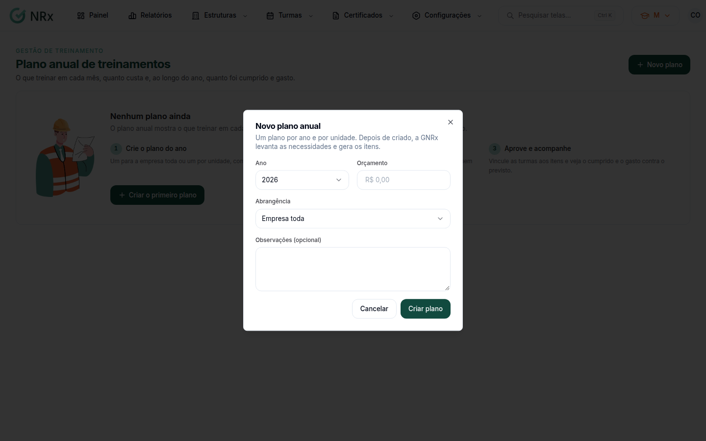
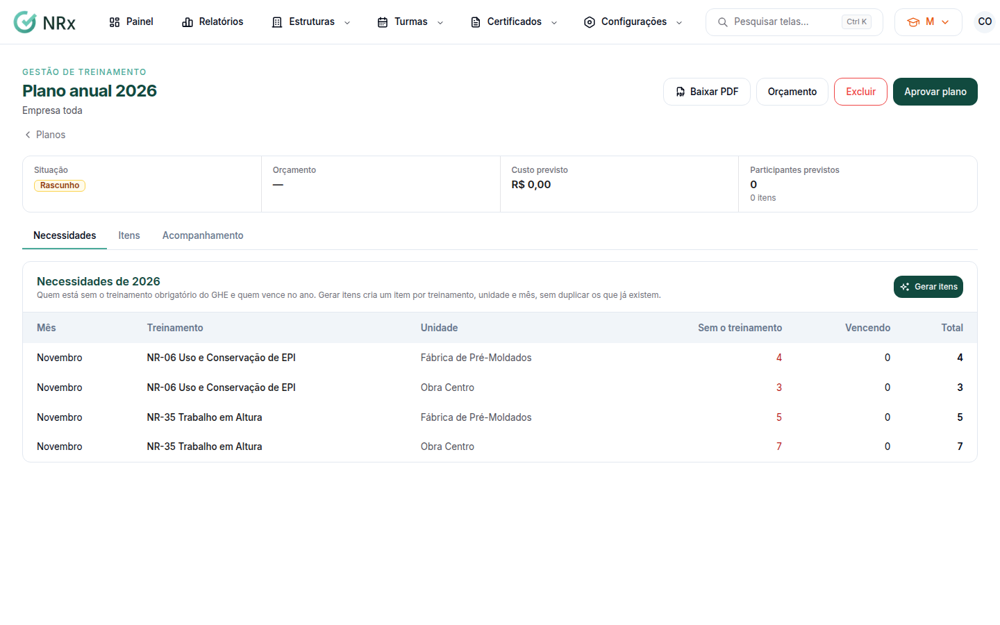

# Montar o plano anual

**Para que serve:** planejar o que treinar em cada mês, quanto custa e, ao longo do ano, quanto foi cumprido e gasto.


**Quem pode fazer:** Supervisor, Gestor ou Administrador, com a permissão de montar o plano anual. Para aprovar: Gestor ou Administrador, com a permissão de aprovar o plano anual.


## Antes de começar

* Para gerar os itens automaticamente, os GHEs precisam ter os treinamentos obrigatórios.

## Passo a passo



### Crie o plano

Clique em **Turmas › Plano anual** e depois em **Novo plano**. Escolha o **Ano** e a **Abrangência** (**Empresa toda** ou uma unidade). Se quiser, escreva as observações. Clique em **Criar plano**.

<figure><figcaption>
Novo plano anual
</figcaption></figure>



### Gere os itens

Na aba **Necessidades**, veja quem está sem o treinamento obrigatório do GHE e quem vence no ano. Clique em **Gerar itens**. Sai um item por treinamento, unidade e mês, sem duplicar os que já existem.

<figure><figcaption>
Necessidades
</figcaption></figure>



### Ajuste os itens

Na aba **Itens**, clique no item e ajuste **Mês previsto**, **Centro de custo**, **Participantes previstos** e **Custo previsto**. Clique em **Salvar**. Para incluir algo fora das necessidades, clique em **Item manual** e escolha do catálogo.



### Aprove

Clique em **Aprovar plano** e confirme em **Aprovar o plano?**. Aparece "Plano aprovado.". O plano fica registrado com você como aprovador.




Depois de aprovado, não dá mais para gerar itens pelas necessidades.


## Dúvidas comuns

Como acompanho o que foi cumprido?

Na aba **Acompanhamento**: **Aderência dos itens**, **Aderência dos participantes**, **Gasto até agora**, **Orçado e gasto por mês** e **Orçado e gasto por centro de custo**. Um item é realizado quando tem ao menos uma turma concluída. Vincule a turma ao item ao programar ou editar a turma.

Como fecho o ano?

Clique em **Encerrar** e confirme em **Encerrar o plano?**. O plano encerrado não muda mais. O acompanhamento continua disponível.

O centro de custo não aparece.

O sistema avisa: "Os centros de custo ficam na Gestão de EPI e não estão disponíveis aqui."

Posso apagar um plano?

Um rascunho, sim: clique em **Excluir** e confirme em **Excluir o plano?**. Os itens saem de vez e as turmas vinculadas ficam sem item.

