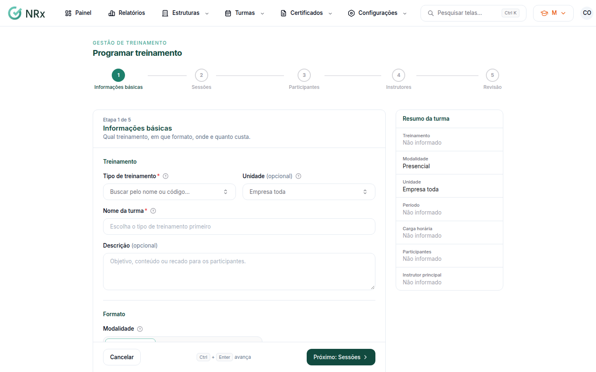
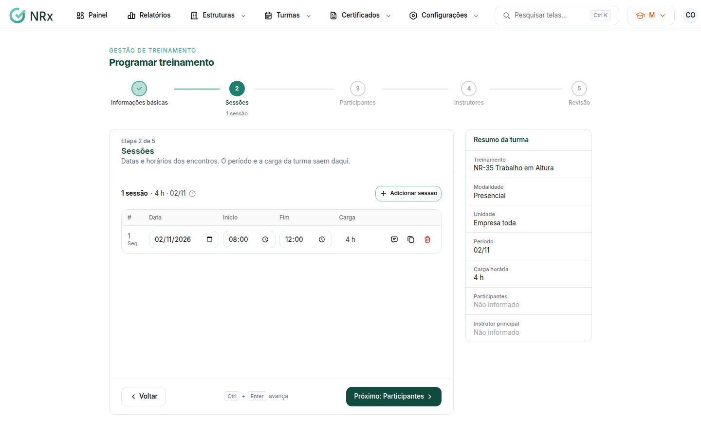
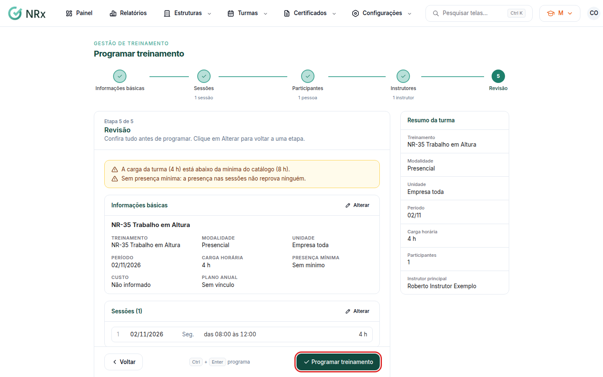

# Programar um treinamento

**Para que serve:** criar uma turma: qual treinamento, quando, quem participa e quem ministra.


**Quem pode fazer:** Gestor ou Administrador, com a permissão de criar treinamentos.


## Antes de começar

* O tipo de treinamento precisa estar no catálogo (**Configurações › Tipos de Treinamentos**).
* Cadastre os [instrutores](../estruturas/instrutores/criar-instrutor.md) e os [colaboradores](../estruturas/colaboradores/criar-colaborador.md).

## Passo a passo



### Informações básicas

Clique em **Turmas › Novo Treinamento**. Em **Tipo de treinamento**, busque pelo nome ou código. O nome da turma começa com o nome do treinamento e pode ser mudado. Escolha a **Unidade** (em branco = **Empresa toda**), a **Modalidade** (**Presencial**, **EAD** ou **Semipresencial**), o **Custo total** e a **Presença mínima** (ou **Sem mínimo**). No EAD e no semipresencial, informe **Abre em** e **Prazo para concluir**.

<figure><figcaption>
Informações básicas
</figcaption></figure>



### Sessões

Clique em **Adicionar sessão** e informe **Data**, **Início** e **Fim**. **Repetir no próximo dia útil** copia a sessão. No EAD, as sessões são opcionais.

<figure><figcaption>
Sessões
</figcaption></figure>



### Participantes

Busque por nome, CPF, matrícula ou e-mail e marque quem vai fazer o treinamento. Só aparecem colaboradores ativos.



### Instrutores

Marque quem ministra e clique em **Tornar principal** em um deles. O principal aparece no certificado e na lista de presença. No EAD, o instrutor é opcional.



### Revisão

Confira tudo. Para voltar a uma etapa, clique em **Alterar**. Clique em **Programar treinamento**. A turma é criada e abre a página dela.

<figure><figcaption>
Revisão
</figcaption></figure>



## Deu errado?

| Mensagem na tela | O que fazer |
| --- | --- |
| "Escolha o tipo de treinamento." | Busque e escolha o treinamento. |
| "Dê um nome à turma." | Preencha o nome. |
| "Adicione pelo menos uma sessão." | No presencial, cadastre ao menos uma sessão. |
| "Selecione pelo menos um participante." | Marque os participantes. |
| "Selecione pelo menos um instrutor." / "Marque um instrutor como principal." | Escolha os instrutores e clique em **Tornar principal**. |
| "O prazo para concluir precisa vir depois da abertura." | Confira as datas. |
| "O fim precisa vir depois do início." | Confira os horários da sessão. |

## Dúvidas comuns

Sou Supervisor e não consigo programar.

Programar exige a permissão de criar treinamentos. Peça ao administrador.

O que a presença mínima faz?

É o percentual das sessões que o participante precisa ter para ser aprovado. Sem mínimo, a presença não reprova.

O instrutor não aparece na lista.

Clique em **Cadastrar instrutor** e depois em **Atualizar a lista**.

