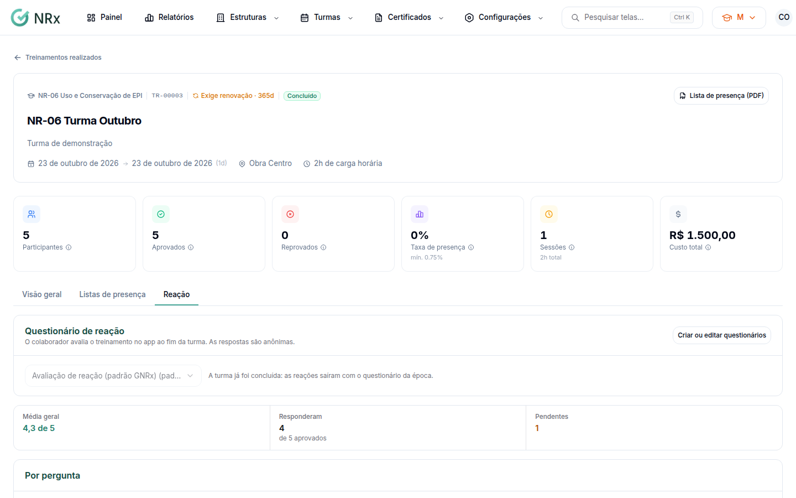

# Ver a reação dos participantes

**Para que serve:** escolher o questionário que o colaborador responde no app ao fim da turma e ver as respostas, que são anônimas.


**Quem pode fazer:** para escolher o questionário, Supervisor, Gestor ou Administrador, com a permissão de editar turmas. Para ver as respostas, quem tem a permissão de ver turmas.


## Antes de começar

* Para usar outro questionário, crie-o em **Configurações › Questionários**.

## Passo a passo



### Escolha o questionário

Abra a turma e vá à aba **Reação**. Em **Questionário de reação da turma**, deixe **O do catálogo do treinamento** ou escolha outro. Aparece "Questionário de reação da turma salvo.".

<figure><figcaption>
Aba Reação
</figcaption></figure>



### Veja as respostas

Depois da conclusão, a reação fica pendente para os aprovados no app do colaborador e no Portal do aluno (com CPF e PIN). Não há link sem login. A aba mostra a **Média geral**, as respostas **Por pergunta** e os comentários, sem o nome de ninguém.



## Dúvidas comuns

Posso trocar o questionário depois de concluir?

Não. A turma já foi concluída: as reações saíram com o questionário da época.

Apareceu "Nenhuma reação ainda".

As reações saem na conclusão da turma, para cada aprovado.

