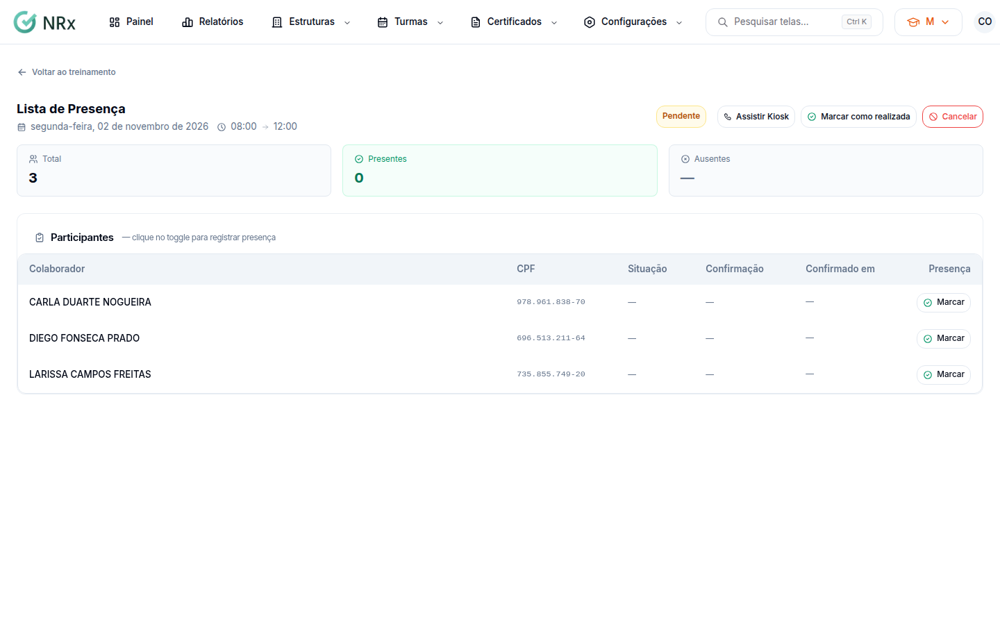
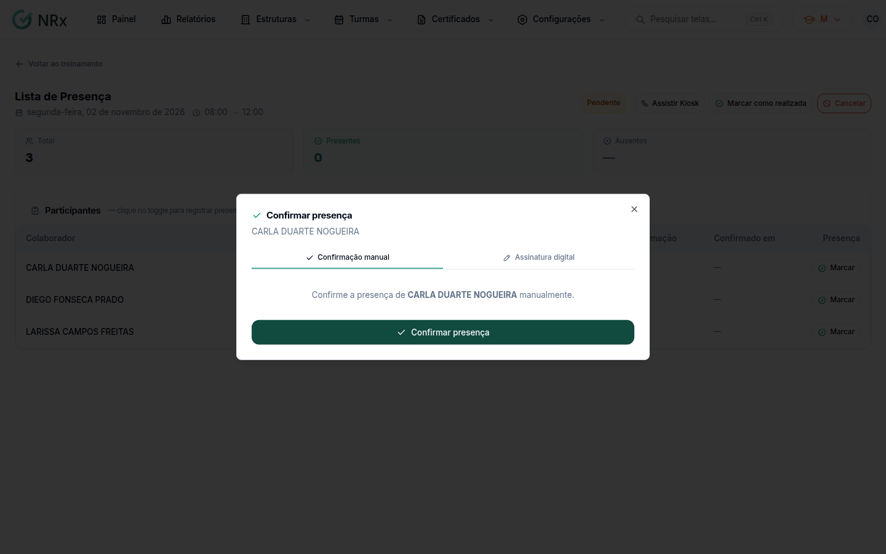

# Registrar a presença

**Para que serve:** marcar quem esteve em cada sessão, com assinatura, reconhecimento facial ou confirmação manual.


**Quem pode fazer:** Supervisor, Gestor ou Administrador, com a permissão de registrar presença.


## Antes de começar

* [Inicie a turma](iniciar-turma.md).

## Passo a passo



### Abra a lista da sessão

Na turma, em **Sessões**, clique em **Ver lista**. Abre a **Lista de Presença**, com **Total**, **Presentes**, **Ausentes** e **Taxa de presença**.

<figure><figcaption>
Lista de Presença
</figcaption></figure>



### Confirme a presença

Na linha do colaborador, clique em **Marcar**. Na janela **Confirmar presença**, escolha:

* **Confirmação manual**;
* **Assinatura digital:** o colaborador desenha e você clica em **Confirmar com assinatura**;
* **Rec. Facial:** o colaborador olha para a câmera.

Aparece "Presença confirmada.", "Presença confirmada com assinatura." ou "Presença confirmada com reconhecimento facial.".

<figure><figcaption>
Confirmar presença
</figcaption></figure>




**Para vários de uma vez:** clique em **Assistir Kiosk**. A **Lista de Presença** abre em tela cheia, com busca: cada colaborador procura o próprio nome e assina a presença. Use num tablet ou num computador na porta da sala.


## Deu errado?


**"Por favor, assine antes de confirmar."**: o colaborador precisa assinar no campo.



**"Documentação irregular impede participar do treinamento: ..."**: com o bloqueio documental ligado, regularize os documentos no módulo Gestão de Documentos ou peça lá uma liberação excepcional.


## Dúvidas comuns

Marquei a pessoa errada.

Clique em **Desmarcar** na linha dela.

A coluna Confirmação mostra o quê?

Como a presença foi confirmada: **Manual**, **Assinatura** ou **Facial**.

