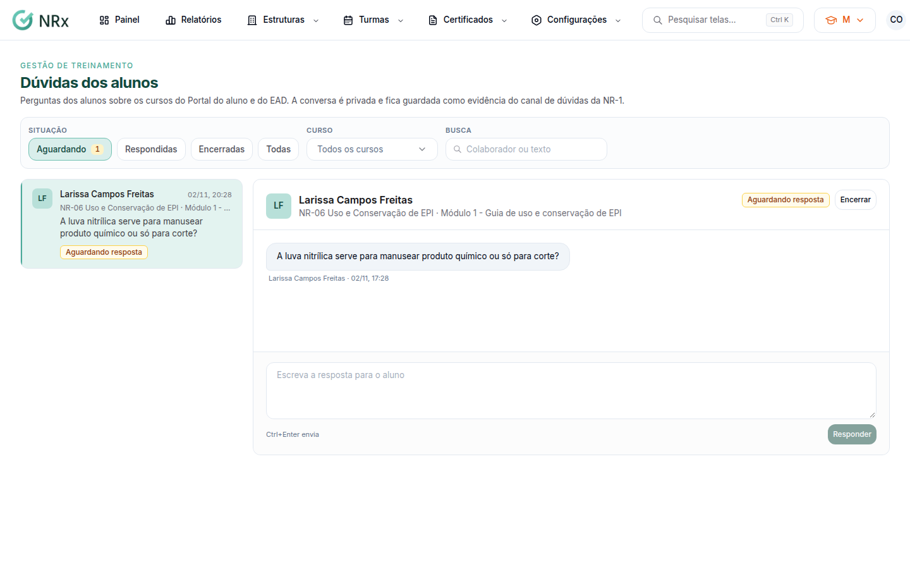

# Responder as dúvidas dos alunos

**Para que serve:** responder as perguntas dos alunos sobre os cursos do Portal do aluno e do EAD. A conversa é privada e fica guardada como evidência do canal de dúvidas da NR-1.


**Quem pode fazer:** Supervisor, Gestor ou Administrador, com a permissão de gerenciar o conteúdo do EAD.


## Antes de começar

* Nada a preparar.

## Passo a passo



### Abra as dúvidas

Clique em **Turmas › Dúvidas dos alunos**. Filtre por **Situação**, **Curso** (**Todos os cursos**) ou pela **Busca** (colaborador ou texto). Clique numa dúvida da lista.

<figure><figcaption>
Dúvidas dos alunos
</figcaption></figure>



### Responda

Escreva em **Escreva a resposta para o aluno** e clique em **Responder**. Aparece "Resposta enviada. O aluno recebe um aviso no app.".



### Encerre (se resolveu)

Clique em **Encerrar**. Aparece "Dúvida encerrada.".



## Dúvidas comuns

A dúvida encerrada pode voltar?

Pode. O aluno ainda pode escrever de novo, e a dúvida reabre.

Apareceu "Caixa vazia".

Nenhuma dúvida esperando resposta.

