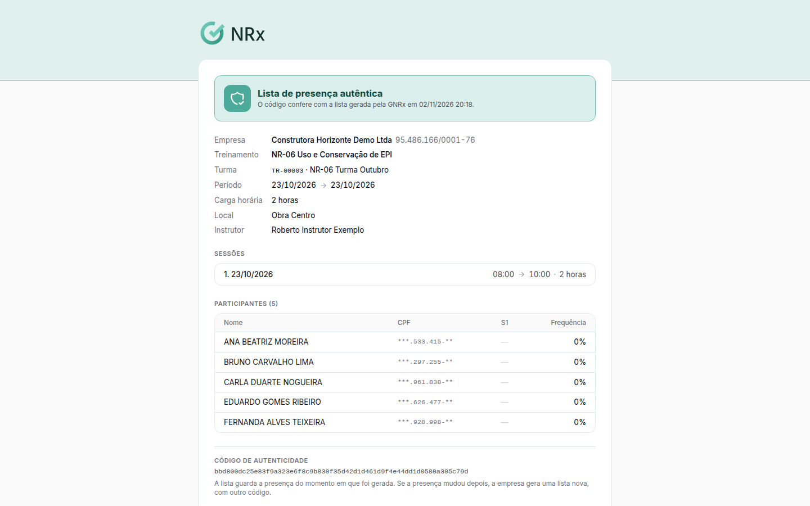

# Verificar uma lista de presença

**Para que serve:** conferir se uma lista de presença de treinamento é autêntica, pelo QR Code ou pelo código do PDF.


**Quem pode fazer:** qualquer pessoa com a lista em mãos. Não precisa entrar no GNRx.


## Antes de começar

* Tenha a lista em PDF, com o QR Code ou o código de autenticidade. Veja [Gerar a lista de presença](../turmas/gerar-lista-presenca.md).

## Passo a passo



### Abra a verificação

Aponte a câmera para o QR Code da lista. Ou abra a página **Verificar lista de presença** e cole o código de 64 caracteres. Clique em **Verificar**.



### Confira

Aparece **Lista de presença autêntica**, com o treinamento, a turma, o período, a carga horária, o local, o instrutor, as sessões e a frequência de cada participante.

<figure><figcaption>
Lista de presença autêntica
</figcaption></figure>



## Deu errado?


**"Código não encontrado"**: confira se o código foi copiado inteiro.


## Dúvidas comuns

A presença mudou depois de gerar a lista.

Cada PDF guarda a presença do momento em que foi gerado. Gere outra lista.

Quem pode ver essa página?

Qualquer pessoa com o código ou o QR Code da lista.

